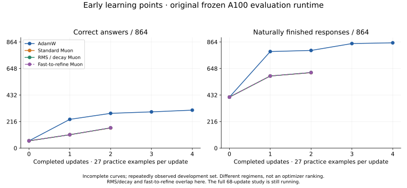

# First COW evaluation data block

The original MiniCPM5-2B F32 completed the same 864 questions with **identical
sampled token sequences, answer outcomes and completion outcomes** through
both execution paths. Both scored **59 correct and 415 naturally finished**.
No training or model update happened in this comparison.

| Evaluation path | Evaluation wall time | Correct / 864 | Naturally finished / 864 |
| --- | ---: | ---: | ---: |
| Independent fresh-context reference | 116.5 minutes | 59 | 415 |
| Existing COW consumed-request path used by BW | 19.1 minutes | 59 | 415 |

The measured ratio was **6.1x**, saving **97.4 minutes** for this assessment.
These were different shared A100 cards with other users active and uncontrolled
loads. This is an observed comparison, not an isolated hardware benchmark or
a guaranteed speedup. Evaluation wall time includes model startup and final
checks; preflight input hashing before the evaluator timer is excluded.

PCC's conservative headline remains **4.8x faster on small forward-work probes**:
the lower of the two initial observed ratios, which ranged from 4.8x to 7.1x.
It is not a universal lower bound. The full 6.1x observation is a separate
measurement, not an extrapolation from those probes.

## The trained-model result: 40.3 to 15.1 minutes

The trained AdamW update-1 model also completed all **864 questions with identical
generated token sequences, answer outcomes and completion outcomes**: **234 correct,
786 naturally finished** through both paths. Fresh evaluation took **40.3 minutes**;
COW took **15.1 minutes**, an observed **2.7x** ratio and **25.2 minutes saved**.
These are the same trained weights in both executions; this comparison adds no
training. The shared-card/load and timer caveats above apply here too.


### Does this shorten the experiment?

Yes: evaluation repeats after every update. If the trained-model observation held
for all 68 updates, it would save approximately **28.6 serial evaluation hours per
arm**. That is a conditional projection, not a finish-time forecast. Later models
may generate different response lengths, cards have other loads, and parallel
arms overlap in calendar time. Training, checkpoint copies and qualification
still take time. The new shared-prefix mode has separate measurements underway.

For an evaluation fraction `f` and evaluation speedup `s`, whole-work speedup is
`1 / ((1 - f) + f / s)`. At `s = 2.67`, assumed evaluation fractions of 60%, 80%
and 90% imply approximately **1.6x, 2.0x and 2.3x** overall. These fractions are
illustrations; we have not measured a complete 68-update loop on the new path.

## What improved

S3's old correctness evaluator repeatedly recomputed the full prefix in a new
context for each predicted token. The new optional adapter calls the existing
COW `BranchingModel` consumed request used by BW's COW serving path. COW keeps
the decode context alive and appends generated tokens. The same weights,
rendered questions, exact checker, 512-token context/batch, greedy policy,
64-output-token bound and EOS IDs were used.

This is an execution-path improvement. It does not explain earlier learning
gains from training, improve the model's answers, or show that BW's shell-task
failures are fixed. BW uses this shared execution pathway; this particular
direct-answer assessment does not run a BW tool/task workflow.

The fresh reference remains independent. Before the full assessment, 18
full-vocabulary comparisons on two owned practice prefixes and eight continuation
tokens each passed the existing maximum/RMS bounds of `2e-4`/`5e-5`, selected
the same next tokens, restored saved state bit-exactly and repeated canonical
requests without prior-case tail contamination. The first package omitted the
curriculum catalog and failed before inference; that infrastructure failure
was retained and corrected without changing weights or gates.

## CPU analysis now runs independently and merges deterministically

The supported `sss_integration.execution_analysis` command uses bounded CPU
processes to analyze separate completed assessment artifacts, then merges their
observations by assessment label. It verifies raw case coverage and identity
against completed summaries, rejects mismatches/incomplete evidence, and does
not load models, run a GPU, regrade answers or write the original evidence.

On the actual A100 host, four workers analyzed six completed assessments
(5,184 case records) with the same report content identity as serial execution.
The measured sequence was:

| Order | Workers | Analysis wall seconds |
| --- | ---: | ---: |
| First serial pass | 1 | 6.197 |
| Parallel pass | 4 | 0.304 |
| Parallel pass | 4 | 0.213 |
| Warm serial pass | 1 | 0.374 |

The first serial pass is confounded by storage/cache warming. We do not call
this a 20x CPU speedup. Against the warm serial pass, observed parallel ratios
were about 1.2x to 1.8x on this small analysis workload. The larger design gain
is that independent analysis can proceed outside the GPU worker's critical path.

The complete COW assessment spent 1,109 seconds inside case timers, with 801
seconds inside the nested request timers and 333 inside the nested generation
timers. Those intervals overlap: **do not add them**. The remaining work includes
prefix computation, context creation/restore, state capture, controller handling,
publication and bookkeeping. These measurements do not isolate pure GPU time
or establish that all remaining time is CPU work.

Example, from an environment with S3 installed:

```sh
python -m sss_integration.execution_analysis \
  --assessment baseline=/absolute/completed/baseline \
  --assessment candidate=/absolute/completed/candidate \
  --workers 4 --output /absolute/new-execution-report.json
```

## Early training observations in the same block

These are separate, ongoing equal-update learning experiments using the original
fresh A100 evaluator. Each update presents the next 27 examples in the same
ordered practice stream. The assessment remains the same repeatedly observed
development set; it is not sealed qualification.

| Full-weight regimen | Update | Correct / 864 | Naturally finished / 864 |
| --- | ---: | ---: | ---: |
| Original | 0 | 59 | 415 |
| AdamW | 1 | 234 | 786 |
| AdamW | 2 | 283 | 795 |
| AdamW | 3 | 295 | 851 |
| AdamW | 4 | 309 | 857 |
| Standard Muon | 1 | 109 | 587 |
| RMS/decay Muon | 1 | 109 | 587 |
| Fast-to-refine Muon | 1 | 109 | 587 |
| Standard Muon | 2 | 164 | 614 |
| RMS/decay Muon | 2 | 165 | 615 |
| Fast-to-refine Muon | 2 | 165 | 615 |

This is not an optimizer ranking. Rates, decay and regimens differ, and
a few updates cannot establish convergence or generalization. Exact optimizer
state and example cursors continue between updates. Full-model and optimizer
files stay on their own machines; only source and results are published.
The LoRA arm's failed all-position merged-logit gate stays separate; a correct
saved weight merge and bit-exact direct-adapter serving on three prefixes have
additional evidence, not a waiver of that failure.



The lines stop at completed observations. This is not the requested final
68-update gain/loss graph or the full-versus-LoRA comparison; those remain open.
The two RMS/decay curves overlap before the scheduled refinement changes.

## Parallel execution and shared input

The two-card 432+432 case split produced identical tokens and scores, but its
**21.8 minutes** was slower than the earlier serial COW run's **19.1 minutes**
and used more allocated GPU time. We retain that negative result. Shared loads
and slightly different timer scope prevent an isolated scaling conclusion.
See [case sharding, checked merges and CPU profiling](COW-EVALUATION-SHARDS.md).

The optional `--cow-shared-prefix` mode now uses COW's established branch
mechanism to retain the longest common rendered input as one root and branch
each independent question from it. Its setup and suffix work have separate
counters. A new baseline and runtime identity distinguish that execution schedule;
the original COW core and fresh reference remain unchanged.

The owner continuation driver has been switched to the shared-root evaluator
and launched from exact saved AdamW update 4 / Muon update 2 states. It keeps
the same next examples and optimizer settings. Available-device admission waits
without holding a GPU lease, then independently places training and evaluation.
New assessments wait for the new baseline to finish. This is deployed integration,
not a claim that all 68 updates have completed or that waiting time is eliminated.

## Next iteration

1. Complete the shared-root baseline and continue the independent native arms;
   retain old results and backfill earlier milestones under the new runtime.
2. Measure admission, native update, evaluation, CPU analysis and archival separately.
   Keep useful independent work outside each arm's ordered update chain.
3. Publish early summaries before expanding quantization/training/harness combinations.
   Improvements may belong in S3, PCC/COW or BW according to the measured cause.

Rebuild these figures with optional matplotlib installed:
`python scripts/plot_cow_first_block.py`. The script reads public aggregates;
it never loads weights or protected questions.

Aggregate evidence:

- [Complete trained-model execution comparison](../validation/minicpm-native-learning-20261024/cow-trained-first-block.json)
- [Additional early learning points](../validation/minicpm-native-learning-20261024/cow-pre-migration-learning-points.json)
- [Full original-model execution comparison](../validation/minicpm-native-learning-20261024/cow-first-block.json)
- [Actual CPU analysis, timings and early learning points](../validation/minicpm-native-learning-20261024/cpu-execution-analysis.json)
- [PCC native reuse implementation and numerical proof](https://github.com/CC-David-CC/Private_Context_COW/blob/feat/native-learning-curves-20261024/docs/COW-EVALUATION.md)
- [LoRA merge/serving diagnostic scope](https://github.com/CC-David-CC/Private_Context_COW/blob/feat/native-learning-curves-20261024/docs/LORA-MERGE-DIAGNOSTICS.md)
