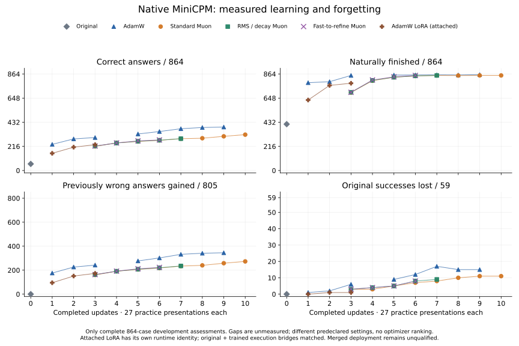

# Native MiniCPM learning through COW

The full-weight snapshot contains 45 completed A100 training assessments and the original-model
baseline, captured 2026-10-25T10:49:05Z. All use the same frozen 864 development
questions, exact checker, 512-token context, greedy decoding and 64-token output
limit. Each native update presents the next 27 examples from the fixed practice
stream. No evaluation answers enter that stream.

The figure also overlays six independently completed attached-LoRA observations,
with separate runtime identity and controlled execution bridges. It shows
correct answers, natural stopping, previously wrong answers
gained, and original successes lost. Every plotted point is a complete assessment;
gaps are not interpolated. The loss panel is out of the original model's 59
successes, rather than all 864 questions.

Latest completed point in each regimen (these update counts differ):

| Regimen | Completed updates | Correct / 864 | Naturally finished / 864 | Newly correct vs original | Original successes lost |
| --- | ---: | ---: | ---: | ---: | ---: |
| Original | 0 | 59 | 415 | 0 | 0 |
| AdamW full | 11 | 388 | 860 | 342 | 13 |
| Standard Muon full | 14 | 374 | 855 | 329 | 14 |
| RMS/decay Muon full | 12 | 353 | 855 | 306 | 12 |
| Fast-to-refine Muon full | 8 | 303 | 853 | 255 | 11 |
| AdamW LoRA, attached | 6 | 298 | 853 | 243 | 4 |

At a common six updates, all five series have seen 162 practice presentations:

| Regimen at update 6 | Correct / 864 | Naturally finished / 864 | Newly correct | Original successes lost |
| --- | ---: | ---: | ---: | ---: |
| AdamW full | 349 | 855 | 302 | 12 |
| Standard Muon full | 270 | 846 | 218 | 7 |
| RMS/decay Muon full | 271 | 847 | 220 | 8 |
| Fast-to-refine Muon full | 274 | 851 | 223 | 8 |
| AdamW LoRA, attached | 298 | 853 | 243 | 4 |

These are observations under the predeclared settings, not an optimizer ranking
or a claim that any learning rate is optimal. A larger total does not erase the
original successes lost. The original model's 59 successes are a small reference
set; the separate per-skill and gate aggregates remain in the data.

Earlier checkpoints have been backfilled under this exact runtime without
replaying their native updates. Each full-weight arm now has every completed
update from one through its latest plotted point. Identical weight artifacts can reference one
assessment, with explicit aliases rather than being counted as independent
trials. The artifact preserves each observed point and every skill/gate change.

The controlled 68-update comparison keeps its declared practice stream fixed.
Changing lessons for only one arm midway would change the experiment. A later
adaptive block can use the observed failure families to generate new verified
practice and mixed review, without copying these development answers.

At six updates, full AdamW has 51 more correct answers than attached LoRA,
while losing eight more of the original successes. These are different observed
learning/forgetting tradeoffs under the declared recipes, not a general verdict
on full training versus LoRA.

The separately bound LoRA hat reaches 298/864 correct after six updates, with
243 answers gained and four original successes lost. Its runtime identity differs
explicitly; original-model and saved trained-model bridge controls matched all
864 sampled sequences, and the native binaries are byte-identical. The overlay
retains these distinct declarations rather than labelling every series as one
runtime. The original merge-equivalence failure remains unchanged. See [the
learning data, controls and repeatable report command](MINICPM-DIRECT-LORA-LEARNING.md).

## Execution and timing

S3 uses PCC's existing COW consumed request, the same underlying request used
by BW. The 28-token common rendered input is materialized once, and each
question branches from that root. Setup work is counted separately. These
direct-answer tests do not execute a BW tool workflow.

The new original-model baseline produced **identical sampled token sequences
and outcomes on all 864 questions** to the saved previous COW assessment:
59 correct and 415 naturally finished. Runtime identity changed explicitly to
bind the shared-prefix policy and the frozen implementation.

This baseline took **67.0 minutes** under its shared A100 load, versus **19.1
minutes** for the earlier COW run. Workload and timing conditions differed;
this is not evidence that saving 28 prefix tokens caused a slowdown, and it is
not a new speedup claim. The earlier [original/trained execution comparisons](COW-FIRST-DATA-BLOCK.md)
and their observed 6.1x / 2.7x ratios remain separate measurements.

Candidate assessments now proceed independently of the baseline's scheduling.
Learning/forgetting comparisons require its completed matching result. Native
updates remain ordered within each arm, with exact moments and example cursors
continued from their saved checkpoints. Models stay on their own hosts.

The runs are repeatedly observed development measurements. Sealed acceptance,
the complete 68-update curves, the matched-practice LoRA curve and broad
administration/tool/research qualification remain unfinished.

[Aggregate counts, skill/gate changes and evidence identities](../validation/minicpm-native-learning-20261024/shared-learning-block-aq.json).
The raw private responses and model files are not published.

## Placement on the shared server

A later owner audit found an AdamW update-10 assessment getting roughly 9-11%
process SM activity while another workload used 88-98%, with two suitable cards
idle. The placement preference put memory fragmentation ahead of utilization.
The corrected owner preference considers observed utilization first, retaining
the same memory admission and PCC GPU leases. All four A100 full-weight arms
were handed off independently after their native checkpoints were verified.

The old assessment completed **543 questions in 127.3 minutes**. Reassessing that
same saved model completed **all 864 in 9.3 minutes** on a less contended card.
Every overlapping sampled sequence and case outcome matched exactly. Original
partial evidence was retained, native update 10 was not repeated, and the
numerical runtime/checker/policy stayed fixed. This is an operational placement
observation across different shared loads and panel lengths. It does not isolate
an algorithm throughput gain. A nearly finished fast-to-refine assessment was
allowed to finish and its complete result reused with zero duplicate allocation.

[Placement observations and overlap control](../validation/minicpm-native-learning-20261024/evaluation-placement-ap.json)
keep the model/runtime identities, counts and timing limits alongside the data.
