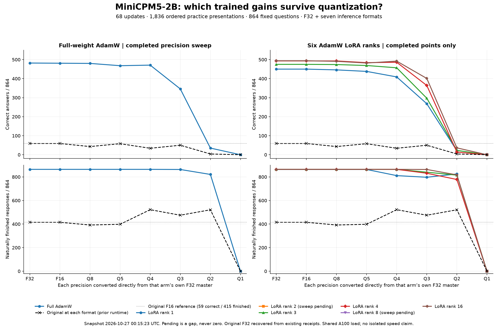

# Final-checkpoint precision: full AdamW and six LoRA ranks

Snapshot: 2026-10-27T00:15:23.705550+00:00. **39 completed model/format panels**,
each containing all 864 frozen questions. Every trained arm completed 68 updates
and 1,836 ordered practice presentations. Full AdamW and LoRA ranks 3, 4 and 16
have complete sweeps. Rank 1 has seven completed formats; Q1 is still running.
Ranks 2 and 8 have completed training and are performing their first merge/audit
and precision sweeps. Muon precision measurements are outside this snapshot.

The original model appears at each measured format, with its F16 score also
shown as a horizontal reference: **59 correct, 415 naturally finished**.
Original F32 was recovered from an existing completed run: all 864 saved responses were independently regraded and decoded, with no new inference. The original sweep used a prior runtime; it is a
historical reference, not a matched-runtime estimate of training alone. Pending
values are gaps, never zeros.

## Correct answers out of 864

| Format | Original | Full AdamW | LoRA r1 | LoRA r2 | LoRA r3 | LoRA r4 | LoRA r8 | LoRA r16 |
| --- | ---: | ---: | ---: | ---: | ---: | ---: | ---: | ---: |
| F32 | 59 | 482 | 450 | pending | 475 | 493 | pending | 494 |
| F16 | 59 | 481 | 450 | pending | 475 | 493 | pending | 494 |
| Q8_0 | 43 | 480 | 446 | pending | 474 | 493 | pending | 491 |
| Q5_K_M | 58 | 468 | 438 | pending | 469 | 484 | pending | 482 |
| Q4_K_M | 34 | 471 | 409 | pending | 457 | 486 | pending | 492 |
| Q3_K_M | 50 | 346 | 268 | pending | 297 | 364 | pending | 401 |
| Q2_K | 4 | 35 | 21 | pending | 23 | 14 | pending | 36 |
| Q1_0 | 0 | 0 | pending | pending | 0 | 0 | pending | 0 |

## Naturally finished responses out of 864

| Format | Original | Full AdamW | LoRA r1 | LoRA r2 | LoRA r3 | LoRA r4 | LoRA r8 | LoRA r16 |
| --- | ---: | ---: | ---: | ---: | ---: | ---: | ---: | ---: |
| F32 | 415 | 864 | 863 | pending | 864 | 864 | pending | 864 |
| F16 | 415 | 864 | 863 | pending | 864 | 864 | pending | 864 |
| Q8_0 | 392 | 864 | 863 | pending | 864 | 864 | pending | 864 |
| Q5_K_M | 398 | 864 | 863 | pending | 864 | 864 | pending | 864 |
| Q4_K_M | 522 | 864 | 811 | pending | 864 | 864 | pending | 864 |
| Q3_K_M | 475 | 863 | 797 | pending | 840 | 831 | pending | 863 |
| Q2_K | 521 | 821 | 825 | pending | 815 | 778 | pending | 817 |
| Q1_0 | 0 | 0 | pending | pending | 0 | 0 | pending | 0 |

## ELI5

Most of the trained gains survive the useful middle-sized files. Full AdamW
scores 482 in F32 and 471 in Q4; rank 16 scores 494 and 492. Smaller files
eventually lose much more: full AdamW falls to 346 at Q3, 35 at Q2 and zero at
Q1. Stopping and answering correctly are separate abilities: Q2 can finish many
responses while getting almost everything wrong.

The ranks do not have identical tolerance to quantization. Rank 1 drops from
450 to 409 correct at Q4 and loses 52 natural finishes overall. Rank 16 loses
two correct answers overall at Q4 and keeps all 864 natural finishes. Q5 does
not always beat Q4. The measurements decide; a smooth curve is not assumed.

## Master's and PhD level

All formats originate directly from each arm's own F32 master. LoRA masters
were produced by PCC's native merge and independently checked against FP64
weight reconstruction before conversion. Full AdamW already produces a full
F32 model. Its existing completed F32 assessment is reused after exact
runtime/input verification, rather than spending another 864 calls on it.

Within each arm, saved results are paired against its own F32 reference using
the frozen case/checker IDs and qualified COW runtime family. Shared-prefix
evaluation uses greedy decoding, a 512-token context and a 64-token output
limit. The evidence retains actual model/runtime IDs, receipt hashes and
per-skill/gate transitions. This snapshot contains no seed-repeat experiment
and does not establish broad unseen-task generalization.

Totals conceal turnover. Full AdamW's F16 score of 481 combines one gained and
two lost answers relative to its F32 score of 482. Rank 16's Q4 score of 492
combines 20 gained and 22 lost answers relative to 494. Neither is an
all-answer equivalence claim. F16 has identical answer/finish verdicts to F32
for the four measured LoRA ranks; that does not imply identical logits or text.

Four CPU analysis workers collated existing receipts. No inference or training
was repeated for this report. Timing samples came from shared A100s and must
not be read as isolated throughput measurements.

## Applied meaning

Q4 preserves most measured gains for several arms, while rank 1 shows a larger
behavior and stopping loss. Choose from measured skill-level results, model
size and deployment requirements. Q3 and below need separate investigation;
quantization-aware training remains a planned follow-up and was not used here.
No model is promoted, uploaded or declared a universal winner by this chart.

The [training curves](MINICPM-UPDATE-CURVES-PROGRESS.md) compare updates and
optimizer/rank trajectories. The [rank-16 detail](RANK16-PRECISION-PROGRESS.md)
retains its original evidence. Download the
[paired report](results/minicpm-20261026/final-checkpoint-precision.json),
[CSV](results/minicpm-20261026/final-checkpoint-precision.csv) or
[plot source](results/minicpm-20261026/plot_final_checkpoint_precision.py).
The earlier three-rank snapshot remains available in
[its original JSON](results/minicpm-20261026/final-rank-precision.json).
