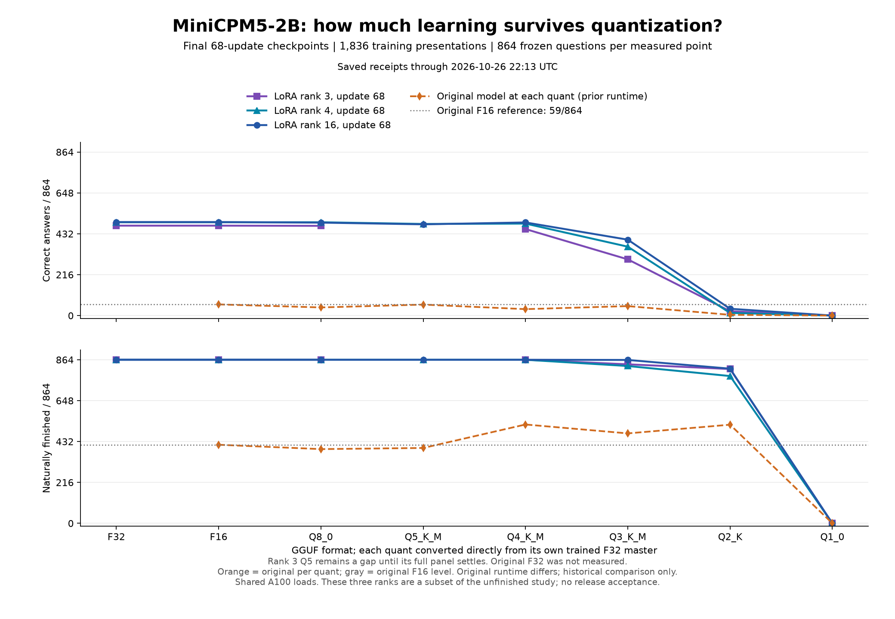

# Final-checkpoint quantization across trained LoRA ranks

These are standalone GGUFs from completed 68-update rank-3, rank-4 and rank-16
training arms. Each received 1,836 ordered practice presentations. The rank-4 and
rank-16 precision sweeps are complete; rank 3 is waiting for its Q5 panel to
settle. Other ranks and full-update optimizers remain outside this snapshot.

Every numeric point is a complete assessment of the same 864 frozen questions.
The original-model line is measured at each quant size, using a prior runtime:
it is a historical reference, not a matched-runtime estimate of training alone.
Original F32 was not measured. The gray horizontal reference is original F16,
59 correct and 415 naturally finished responses. Pending values are not zeros.

| Format | Original correct | Trained rank 3 | Trained rank 4 | Trained rank 16 |
| --- | ---: | ---: | ---: | ---: |
| F32 | not measured | 475 | 493 | 494 |
| F16 | 59 | 475 | 493 | 494 |
| Q8_0 | 43 | 474 | 493 | 491 |
| Q5_K_M | 58 | pending | 484 | 482 |
| Q4_K_M | 34 | 457 | 486 | 492 |
| Q3_K_M | 50 | 297 | 364 | 401 |
| Q2_K | 4 | 23 | 14 | 36 |
| Q1_0 | 0 | 0 | 0 | 0 |

## ELI5

Training's gains largely survived F16, Q8 and Q4 on these questions. They did
not all survive Q3, Q2 or Q1. Rank 4 scored 493 in F32, 486 in Q4 and 364 in Q3.
Rank 16 scored 494, 492 and 401 respectively. Q5 sometimes scored below Q4, so
the measured curve is not perfectly smooth. A similar total can hide different
questions being gained and lost.

## Master's and PhD level

Each adapter was merged into its own F32 master through PCC's native merge path
and independently audited against FP64 weight reconstruction before conversion.
Each precision file was converted directly from that master. Within a rank,
the standalone F32 and quant evaluations use the same frozen case/checker IDs,
COW runtime family, shared-prefix path, greedy decoding, 512-token context and
64-output-token limit. The linked evidence retains actual runtime and model IDs.
F16 agrees with F32 on every answer/finish verdict for all three measured ranks;
this is panel behavior, not a claim of identical logits or generated text.

The [machine-readable report](results/minicpm-20261026/final-rank-precision.json)
includes paired answer/completion gains and losses relative to each rank's own
F32 reference, skill/gate aggregates and hashes of original per-format receipts.
It does not pair different ranks or the original-runtime sweep as though those
were identical executions. One trajectory per arm provides neither seed
variance nor a broad generalization claim. Shared load also prevents treating
these wall-clock times as isolated compute-efficiency measurements.

## Applied meaning

F16 preserves the measured trained behavior here while halving F32 disk size.
Q4 retains most correct answers in a smaller file, but its changed verdicts need
the per-skill retention check before choosing a deployment model. Q3 and below
need separate investigation. Quantization-aware training is planned follow-up;
these results do not measure QAT. No checkpoint is promoted or uploaded by this
analysis. Raw protected responses and all model weights remain private.

See the [full training curves](MINICPM-UPDATE-CURVES-PROGRESS.md),
[rank-16 detailed precision report](RANK16-PRECISION-PROGRESS.md),
[CSV](results/minicpm-20261026/final-rank-precision.csv) and
[plot source](results/minicpm-20261026/plot_final_rank_precision.py).
Four CPU workers collated saved receipts; no training update or model inference
was repeated to build this report.
