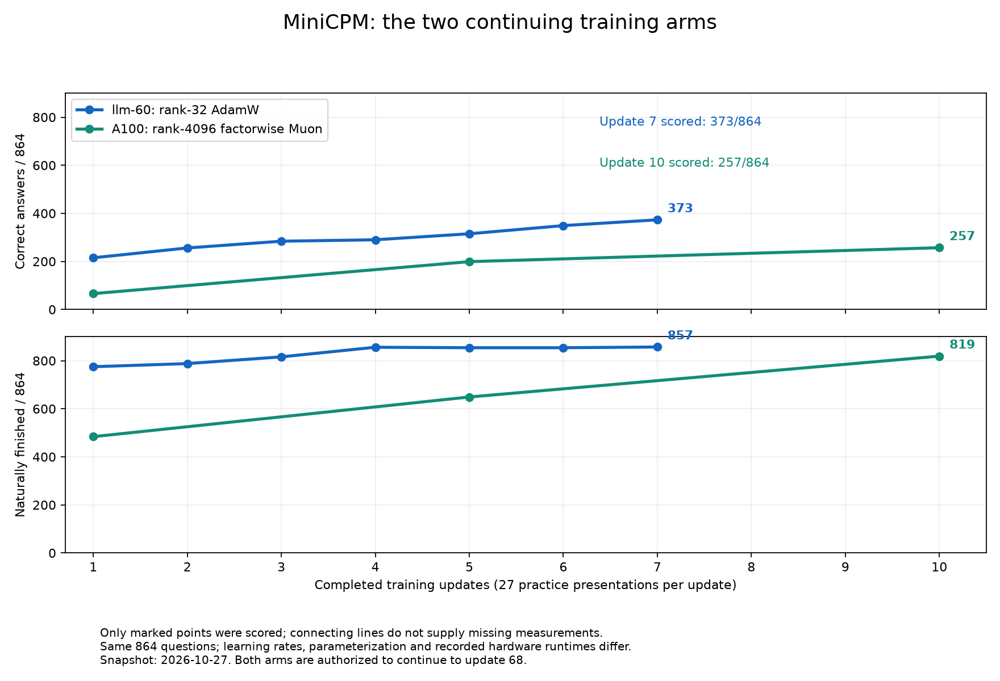
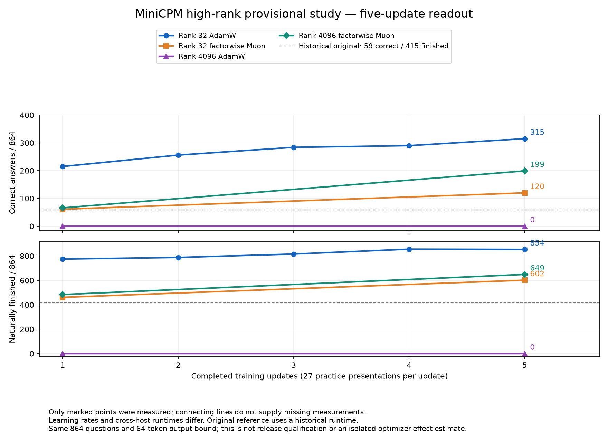

# MiniCPM: walking the LoRA ranks

**The four-arm five-update readout is complete. Rank-32 AdamW and rank-4096 Muon are continuing toward update 68.**

## The two continuing arms

Latest completed points: **rank-32 AdamW update 7: 373/864** (857 naturally finished), and **rank-4096 Muon update 10: 257/864** (819 naturally finished). Both continue independently toward update 68.

| Arm and measured interval | Correct before → after | Answers gained | Answers lost |
|---|---:|---:|---:|
| Rank-32 AdamW, update 5 → 6 | 315 → 349 | 42 | 8 |
| Rank-32 AdamW, update 6 → 7 | 349 → 373 | 31 | 7 |
| Rank-4096 Muon, update 5 → 10 | 199 → 257 | 66 | 8 |
| Rank-4096 Muon, direct update 1 → 10 | 66 → 257 | 195 | 4 |

Muon did lose previously correct answers by update 10. Its initial zero-loss result at update 5 did not persist. The direct first-to-tenth comparison is independently paired; it is not a sum of interval gains/losses. The [paired receipt](results/minicpm-highrank-20261027/muon4096-paired-first-to-ten.json) preserves the group breakdowns. Counts across these different intervals do not isolate an optimizer effect.

Rank-32 update 6 completed its first real rolling archive cycle: model, adapter and optimizer state verified on R730 before cold local copies were retired. The latest continuation state stayed local. Rank-4096 Muon has moved to its update-10-to-20 training block.

## Initial five-update comparison

All counts below use the same 864 questions. Gains and losses compare the
actual update-1 and update-5 answers, not adjacent-step totals added together.

| Regimen | Correct at update 1 | Correct at update 5 | Answers gained | Answers lost |
|---|---:|---:|---:|---:|
| Rank-32 AdamW | 215 | 315 | 122 | 22 |
| Rank-32 factorwise Muon | 61 | 120 | 60 | 1 |
| Rank-4096 AdamW | 0 | 0 | 0 | 0 |
| Rank-4096 factorwise Muon | 66 | 199 | 133 | 0 |

AdamW gained more and lost more in the rank-32 comparison. At rank 4096,
Muon retained all 66 initially correct answers on this panel while gaining
133. That does not establish zero forgetting elsewhere. The regimens have
different learning rates, head-update rates and, across hosts, recorded runtimes;
this is not an isolated optimizer-effect estimate. The two rank-4096 arms use
the same recorded A100 evaluation runtime.

The original dashed line is a historical reference from a different recorded
runtime. Only marked points were measured. No missing measurements are filled
in. Rank-4096 AdamW actually scored zero at both measured endpoints; this is not a missing measurement.

The original ten-arm, 68-update study and all 80 precision panels are complete.
The initial comparison stopped at five updates. The owner then
approved continuing rank-4096 Muon and, subsequently, rank-32 AdamW to 68 updates, each from its saved adapter,
optimizer moments and practice cursor. Milestone assessments are scheduled at
10, 20, 34, 50 and 68 for rank-4096 Muon; rank-32 AdamW is assessed at every new update. Later unmeasured points remain absent from the chart. No seed repeats are scheduled.

Can a larger adapter preserve more useful learning, and how do AdamW and
factorwise Muon differ as adapter rank grows? This extension has its own branch
and report. The [original frozen study](https://github.com/CC-David-CC/sss/blob/feat/minicpm-update-curves-20261026/docs/FINAL-CHECKPOINT-PRECISION.md)
is complete and remains separate from this extension.

## The small reference set

These are measured update-68 results from the original study, all out of 864
questions. Rank 1 was the lowest-scoring and rank 16 the highest-scoring F32
endpoint among its six AdamW LoRA ranks. They are selected examples, not a
replacement for the complete results. Full AdamW and standard Muon supply the
full-weight references. Ties and intermediate ranks remain in the original report.

| Original reference | F32 correct | Q4_K_M correct | Q2_K correct |
|---|---:|---:|---:|
| AdamW LoRA rank 1 | 450 | 409 | 21 |
| AdamW LoRA rank 16 | 494 | 492 | 36 |
| Full AdamW | 482 | 471 | 35 |
| Full standard Muon | 494 | 471 | 28 |

The historical original F32 model scored 59/864. Its runtime differed from the
trained-model runtime, so that historical comparison is not a matched-runtime
estimate of the training effect. The original report records that limitation.
No quantized high-rank results have been measured for this extension.

## The new arms

This extension began as a short provisional comparison and completed five
updates per arm. The owner subsequently extended **rank-4096 Muon and rank-32 AdamW to 68**.
Rank-32 Muon and rank-4096 AdamW remain stopped at five; no further rank-4096 AdamW tests
are scheduled, following the explicit stop instruction.
The current candidates are rank 32 and rank 4096 with AdamW and factorwise Muon.
Ranks 128 and 2048 remain unstarted options, not required work for this readout.

Each update uses 27 examples from the same ordered practice stream. Optimizer
state and the example cursor continue between points; ten updates would mean
270 practice presentations. There is no fixed training-time budget. The original
completed 68-update comparison remains separate and unchanged.

| Rank | Trainable adapter parameters | AdamW | Factorwise Muon |
|---|---:|---|---|
| 32 | 54,476,800 | Update 7: 373/864 correct; 857/864 naturally finished | Update 5: 120/864 correct; 602/864 naturally finished |
| 128 | 217,907,200 | Optional; not started | Optional; not started |
| 2048 | 3,486,515,200 | Optional; not started | Optional; not started |
| 4096 | 6,973,030,400 | Update 5: 0/864 correct; 0/864 naturally finished; stopped | Update 10: 257/864 correct; 819/864 naturally finished |

Snapshot: 2026-10-27. This table records the last inspected state, not a live
monitor. AdamW rank 4096 was dispatched on A100 GPUs 2 and 3; factorwise Muon
on GPUs 0 and 7. These are separate arms, not repeated runs. Both optimizers passed
generated tiny-model two-GPU continuation tests and actual-model persistent
memory admission. Both completed their first native update and verified saved
adapter and optimizer-state artifacts. Both update-1 exports passed whole-weight
and same-input forward checks. On the same frozen A100 runtime, AdamW scored
**0/864 correct, 0 naturally finished**; Muon scored **66/864 correct, 484 naturally
finished**. These are separate correctness and stopping measurements under the
64-token output bound, not a claim about all mathematical knowledge. The
[AdamW](results/minicpm-highrank-20261027/rank4096-adamw-update001.json) and
[Muon](results/minicpm-highrank-20261027/rank4096-muon-update001.json) receipts
bind the models, checks and runtime. Both regimens continued unchanged toward
update 5. AdamW first encountered a graph-memory admission refusal before any
new update; that refusal was preserved and the unstarted block explicitly
relocated with the measured graph-memory requirement. Execution-graph allocation,
saved artifacts and evaluation are separate
gates; persistent admission alone does not establish successful training.

Rank-32 AdamW completed its first update on the separate llm-60 worker. Every
merged weight passed the independent FP64 audit (maximum error 8.98e-8).
Adapter-versus-merged logits on one original practice input differed by
0.000118, within the unchanged 0.0002 bound; loss differed by 0.0000055.
The [export-check receipt](results/minicpm-highrank-20261027/rank32-update001-merge.json)
records that limited scope. Its frozen 864-question assessment completed through
the existing PCC/COW shared-prefix path: **215 correct, 775 naturally finished**.
The [assessment receipt](results/minicpm-highrank-20261027/rank32-update001.json)
includes skill/gate breakdowns and provenance hashes. This is update 1 after 27
practice presentations, not an update-68 endpoint. Its home runtime is recorded
separately from the A100 reference runtimes; the reference table above therefore
does not establish an optimizer-only or rank-only causal effect.

The bounded continuation pilot then resumed the exact adapter, moments and
practice cursor for update 2, exported and checked the result, and completed the
same assessment. It scored **256 correct, 788 naturally finished**, after 54
practice presentations. Relative to update 1, **44 answers became correct and
3 became incorrect**: a net gain of 41, with forgetting measured rather than
hidden by the total. The [update-2 receipt](results/minicpm-highrank-20261027/rank32-update002.json)
includes that paired breakdown. Both assessments used the same recorded home
runtime. The pilot stopped at its declared update-2 boundary; a longer run still
requires the rolling artifact-retention path.

Update 3 then reached **284 correct, 816 naturally finished**, after 81 practice
presentations. Compared with update 2, **34 answers became correct and 6 became
incorrect**; natural completion gained 31 cases and lost 3. The
[update-3 receipt](results/minicpm-highrank-20261027/rank32-update003.json)
binds the same frozen assessment and home runtime. The bounded pilot stopped
at update 3. This is continuing development evidence, not a release acceptance.

The completed rank-32 AdamW pilot reached **290/864 correct at update 4**
and **315/864 at update 5**, with 856 and 854 naturally finished responses,
respectively. Its five-update pilot stopped at 135 practice presentations. A later separately owned continuation resumes at update 6, assesses each new checkpoint through the same PCC/COW path, and archives verified model/adapter/state artifacts to R730 before retiring cold local copies.
The [update-4](results/minicpm-highrank-20261027/rank32-update004.json) and
[update-5](results/minicpm-highrank-20261027/rank32-update005.json) receipts
retain the paired changes and the same recorded home runtime.

Rank-32 factorwise Muon completed its first assessment on the separate RTX 4090
worker: **61/864 correct, 461 naturally finished**, after 27 presentations.
Its [first assessment receipt](results/minicpm-highrank-20261027/rank32-muon-update001.json)
records a different runtime identity from the AdamW worker. This first point
favors the tested AdamW regimen descriptively, but different learning rates and
runtimes prevent attributing the difference to the optimizer alone. Muon then resumed four new updates in one native call and reached **120/864
correct, 602 naturally finished**, at update 5. Relative to update 1, that is
**60 answers gained and 1 lost**, with 150 completion gains and 9 losses.
The [update-5 receipt](results/minicpm-highrank-20261027/rank32-muon-update005.json)
binds the same 4090 runtime. Rank-32 Muon remains stopped at update 5. Rank-32 AdamW has an explicitly authorized continuation to update 68, with the same ordered practice, optimizer moments and example cursor.

AdamW starts at the original LoRA comparator rate, 1e-4. Factorwise Muon starts
with the standard full-Muon comparator's 5e-5 matrix rate and 1e-6 auxiliary
AdamW rate. These are initial comparison settings, not claimed optima. Different
parameterizations and rates make this a regimen comparison, not an isolated
optimizer-effect estimate. Any changed regimen receives a separate identity.

Rank-4096 Muon completed update 5 with **199/864 correct, 649 naturally
finished**. Compared with update 1, it gained **133 answers and lost none of
the 66 previously correct answers** on this panel. Natural completion gained
177 cases and lost 12; correct answers and stopping are separate outcomes.
The [update-5 receipt](results/minicpm-highrank-20261027/rank4096-muon-update005.json)
records the paired skill/gate changes and unchanged A100 runtime. This is zero
observed answer losses on these questions, not proof of no forgetting elsewhere.
Its first bounded pipeline stopped at update 5 without promotion. A separately
owned continuation now targets update 68, with the same training regimen and
no repeated committed updates. The [AdamW update-5 receipt](results/minicpm-highrank-20261027/rank4096-adamw-update005.json)
confirms its independent whole-weight and strict forward checks passed before
the completed assessment scored 0/864, with zero naturally finished responses.
The failed behavior is retained as evidence; the AdamW arm is stopped.

For the same update-1-to-5 interval, rank-32 AdamW gained **122 answers and lost
22**, while rank-32 Muon gained **60 and lost 1**. The
[direct AdamW paired receipt](results/minicpm-highrank-20261027/rank32-adamw-paired-001-to-005.json)
uses the same two endpoints as the Muon comparison. Seventeen of the AdamW
22 answer losses were fraction questions, four were place-value questions,
and one was signed-addition transfer. These identify classes for fresh practice;
protected assessment prompts must not become training examples.

## Interpreting the regimens

The implementation initializes A from a normal distribution with standard
deviation 0.01 and B to zero at every rank. Exported adapter alpha equals rank,
so alpha/rank is one. Increasing rank changes factor geometry and effective
update behavior; the same nominal learning rate does not guarantee the same
change to the merged weights.

The tested AdamW regimen uses 1e-4 for all adapter factors. Factorwise Muon
uses 5e-5 for hidden factors and auxiliary AdamW at 1e-6 for prediction-head
factors. The head rate is therefore 100 times smaller than in the AdamW arm.
These settings are documented experimental inputs, not optimized or equalized
effective update sizes. Rank-dependent update scaling and head learning rate
are possible explanations to investigate; no ablation establishing their
contribution has been run in this short study.

## What increasing rank actually means

The model contains 2,516,756,480 parameters. Its current adapter targets 295
linear matrices, including the prediction head; embeddings and normalization
weights stay frozen. Adapter parameter count is 1,702,400 times rank.

For an m-by-n matrix, rank-r factors contain r(m+n) parameters but, below
saturation, only r(m+n-r) independent degrees of freedom. Rank 2048 already
reaches every targeted matrix's full rank capacity. Rank 4096 does not increase the maximum rank of the merged weight matrix,
but its additional factor dimensions change the optimization geometry. Factorwise
Muon orthogonalizes updates to the larger A and B factors separately; AdamW
uses coordinatewise adaptive updates without that orthogonalization. Extra factor
dimensions can therefore affect both regimens differently even after matrix rank
capacity saturates. Comparing these effects on learning and forgetting is a central
purpose of the high-rank study. Better performance remains an empirical question.

LoRA's bilinear factors do not make its optimizer a Hessian-based second-order
method. Factorwise Muon orthogonalizes updates to A and B independently. It is
different from orthogonalizing a full dense update and then factorizing it.
Prediction-head factors retain auxiliary AdamW updates.

## How to read the forthcoming graphs

Plot completed update number against correct answers, answers gained and lost,
and natural stopping. Missing points stay missing; failed infrastructure is not
a zero capability score. Use the same protected questions and checker for the
fixed comparison. Report runtime identities and changes rather than assuming
that a shared model name establishes equivalence.

Compute time, peak memory, allocation failures and shared-server contention are
outcomes to report, not the axis used to equalize practice. Quality at equal
updates is still distinct from quality per second or per byte of optimizer state.

The broader goal is a reusable S³/BW/PCC learning loop: observe a failure,
verify a lesson, train a candidate, measure learning and forgetting, make an
explicit acceptance decision, preserve the named artifact, and repeat. This
extension informs that machinery; a better score on this repeatedly inspected
development set alone does not establish broad skill mastery or release quality.

Native implementation and qualification are maintained in
[PCC's factorwise-LoRA branch](https://github.com/CC-David-CC/Private_Context_COW/tree/feat/factorwise-muon-lora-20261027).
Its published small-rank milestone and the pending extended-rank work are
distinct. Models, optimizer states and protected response traces remain private.
