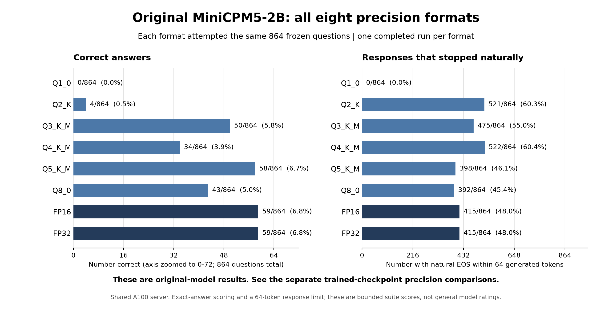

# MiniCPM5-2B: original-model precision results

All eight original-model formats completed the same 864 frozen development
questions: **6,912 scored attempts**. These are existing completed A100
measurements recovered from the evaluation receipts, not new repeat runs.

The original F32 measurement had been omitted from the earlier chart. Its [864-response audit](results/minicpm-20261026/original-f32-existing-evidence.json) verifies the saved model identity, response decoding, independent grading and settlement; no GPU inference was rerun. F32 and F16 had identical answer and finish verdicts.

| Format | Correct / 864 | Correct rate | Natural finishes / 864 |
| --- | ---: | ---: | ---: |
| Q1_0 | 0 | 0.0% | 0 |
| Q2_K | 4 | 0.5% | 521 |
| Q3_K_M | 50 | 5.8% | 475 |
| Q4_K_M | 34 | 3.9% | 522 |
| Q5_K_M | 58 | 6.7% | 398 |
| Q8_0 | 43 | 5.0% | 392 |
| FP16 | 59 | 6.8% | 415 |
| FP32 | 59 | 6.8% | 415 |

The [aggregate CSV](results/minicpm-20261026/original-quantization.csv) includes
format sizes, model hashes, evaluation/runtime identities, completion times and
original result hashes. The [plot script](results/minicpm-20261026/plot_original_quants.py)
regenerates the chart. No question text, answers, model files or credentials are
included.

The [paired-validation receipt](results/minicpm-20261026/original-quantization-validation.json)
records S³'s successful unique-case, aggregate-count and matching-panel checks
for all eight formats. It also preserves per-question gains and losses:

| Format | Newly correct versus FP16 | FP16 successes lost |
| --- | ---: | ---: |
| Q1_0 | 0 | 59 |
| Q2_K | 2 | 57 |
| Q3_K_M | 7 | 16 |
| Q4_K_M | 8 | 33 |
| Q5_K_M | 9 | 10 |
| Q8_0 | 0 | 16 |
| FP16 | 0 | 0 |
| FP32 | 0 | 0 |

Q5's net loss of one answer therefore hides nine gains and ten losses. Near-equal
total scores do not mean the formats retain exactly the same capabilities.

## Plain-language reading

Every format sat the same test. The left panel counts correct answers; the
right counts responses that stopped naturally before the 64-token allowance
ran out. Stopping successfully and answering correctly are different outcomes.
The left axis is zoomed to show the small correct-answer counts clearly.

FP16 scored 59 correct and Q5 scored 58. Q3 scored above Q4, and Q5 above Q8.
That ordering describes these questions and these response limits. It does not
establish that Q3 is generally better than Q4 or Q5 generally better than Q8.
Q1 and Q2 performed poorly on correct answers under this setup.

These are the original model's results. A separate
[seven-format trained-checkpoint panel is now complete](MINICPM-TRAINED-QUANTIZATION.md).
It measures precision retention for an intermediate AdamW update-43 artifact.
The final selected-checkpoint comparison after the 68-update study remains
outstanding. The two precision panels retain different runtime identities.

## Technical reading and limits

All eight receipts report `COMPLETE`, 864 unique scored cases and the same
evaluation and runtime identities. Their independent settlement receipts also
report 864 completed cases. Summary counts and model hashes match the original
evaluation records. The shared runtime identity is
`4a78701cc4d8f1f2951dca642e6ab84f7b1929e37b29805ceefb9615db1a12e5`.

This is a frozen direct-answer development panel with a maximum of 64 generated
tokens and stop IDs 1 and 130073. Exact-answer checks and limited response length
can make results sensitive to formatting, reasoning length and stopping changes.
The chart is not a general capability rating or an estimate over arbitrary user
questions. There is one completed run per format, without repeated seeds.

Each artifact passed the recorded finite/deterministic forward-execution gate.
That gate establishes finite logits and bit-identical repeated forwards for its
probe inputs. It does not establish a separate FP64 reference bound for every
dequantized operation. In particular, Q1's zero score alone does not diagnose
whether a quantizer, kernel or model sensitivity caused the failure.

The work ran on shared A100 hardware. Shared load limits interpretations of
timings; the chart presents behavior counts rather than throughput rankings.
Quantization comparisons of trained artifacts must retain their exact training
checkpoint and base/adapter/merge provenance and their own execution receipts.

## Remaining work

The original seven-format panel and the first intermediate trained seven-format
panel are complete. The fixed 68-update training comparison and additional
trained precision panels continue. Final candidate selection, retention review
and qualified named GGUF preservation remain unfinished. Final cleanup of study
checkpoints follows the report and retention decision; these results do not
authorize deleting required milestone state.

## Reporting correction

An earlier status message and progress snapshot said the quantization matrix
had not started. That was incorrect for the original-model half. Its conversion
receipts say `CONVERTED_NOT_EVALUATED`, while completed evaluations live under a
separate precision-control directory. The chart and table above use those
completed evaluation and settlement records. Existing completed work must not
be queued again merely because a conversion receipt does not contain scores.
