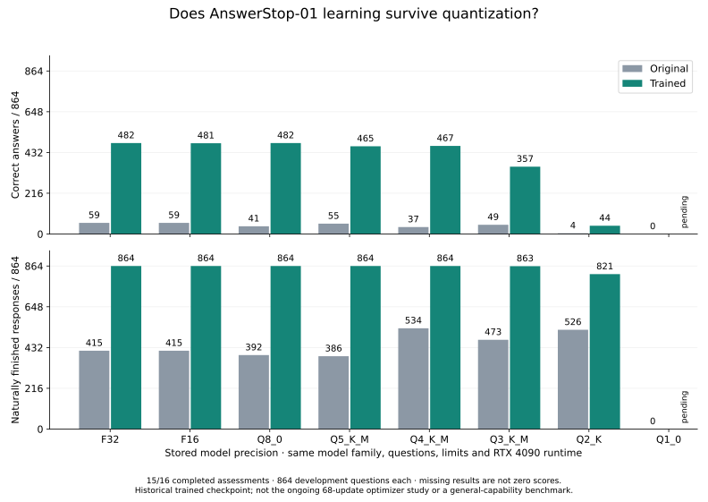

# Does the learned behavior survive smaller model files?

The completed FP16, Q8 and Q4 comparisons retain most or all of the trained
model's aggregate score on this frozen math/state development set. The trained
FP32 checkpoint scores 482/864; FP16 scores 481, Q8 scores 482 and Q4 scores 467.
All four trained variants finish every response naturally. These are measured
full assessments, not estimates from model size or a few selected examples.

| Stored precision | Original correct | Trained correct | Original finished | Trained finished | Trained file size |
| --- | ---: | ---: | ---: | ---: | ---: |
| F32 | 59/864 | 482/864 | 415/864 | 864/864 | 10,072,171,584 bytes |
| F16 | 59/864 | 481/864 | 415/864 | 864/864 | 5,039,006,784 bytes |
| Q8_0 | 41/864 | 482/864 | 392/864 | 864/864 | 2,679,710,784 bytes |
| Q5_K_M | 55/864 | 465/864 | 386/864 | 864/864 | 1,808,061,504 bytes |
| Q4_K_M | 37/864 | 467/864 | 534/864 | 864/864 | 1,561,318,464 bytes |
| Q3_K_M | 49/864 | 357/864 | 473/864 | 863/864 | 1,291,420,736 bytes |
| Q2_K | 4/864 | 44/864 | 526/864 | 821/864 | 1,039,926,336 bytes |
| Q1_0 | 0/864 | 0/864 | 0/864 | 0/864 | 541,475,904 bytes |

The trained FP16 model gains **one** answer and loses **two** relative to its FP32
parent. Its net gain over the original same-format model is 422 answers, versus
423 in FP32. That retains about 99.8% of this measured net score improvement
while roughly halving file size. This is a ratio on this development set, not a
claim that 99.8% of general intelligence survives conversion. FP16 also loses
12 original successes while gaining 434 previously wrong answers; those losses
remain visible for later mixed practice.

Q8 keeps the FP32 total of 482, but it gains two answers and loses two other
answers relative to FP32. Equal totals do not mean identical behavior. Q4 gains
19 and loses 34 relative to FP32, a net loss of 15 answers; it retains about
96.9% of the FP32 correct-answer total in about 15.5% of its file size. Against
the original Q4 artifact, trained Q4 gains 435 answers and loses five, with 330
additional natural completions and no lost completions. Its score is 467 versus
37 on the same quant format. Smaller formats are not assumed to monotonically
reduce quality. These paired changes are observations on this sample.

Original FP16 and FP32 have identical Boolean correctness/completion outcomes
on every case. The trained FP32 score on this RTX 4090 also reproduces the
earlier 482/864 with 864 completions on the RTX PRO 6000. These observations
do not promise identical floating-point logits or every future result across
hardware. The within-table comparisons use one pinned runtime and one GPU.

## What was held fixed

The original and trained variants use the same 864 questions, exact-answer
checker, tokenizer, prompt renderer, native runtime and decoding limits. There
are nine math/state leaves, each with independent, composition and
transfer/recovery gates. Decoding is greedy, thinking is closed in the qualified
template, input context and batch are 512 tokens, and generation is capped at
64 tokens with assistant ending IDs 1 and 130073. No evaluation answers enter
training. The trained source is the historical AnswerStop-01 checkpoint, not a
new update trained during this quantization study.

The oracle recomputes the complete prefix at each generated token. This is a
correctness experiment; its wall times are not production cached-serving
throughput. Conversion uses the pinned llama.cpp-derived quantizer through PCC's
existing model tooling. No new quantization engine or training framework is
introduced. All model binaries remain private on fleet machines.

The trained FP32 run's maximum sampled process memory was 9,288 MiB; FP16's was
6,016 MiB, Q8's 3,036 MiB and Q4's 2,100 MiB. These are one-second `nvidia-smi` process samples, not guaranteed
instantaneous peaks or training VRAM estimates. Model format, runtime buffers
and execution shape all contribute to memory use.

## Repeat the report

The live inference runner writes immutable `FAMILY-FORMAT-summary.json` and
`FAMILY-FORMAT/result.json` files. After a row completes, an agent or person can
regenerate the aggregate without invoking a model:

```sh
python -m sss_integration.quantization_report \
  --directory /path/to/owned-evaluation-matrix \
  --formats F32 F16 Q8_0 Q5_K_M Q4_K_M Q3_K_M Q2_K Q1_0 \
  --output quantization-progress.json
```

The output path must be new. The report checks complete unique case outcomes,
reconciles totals and model identities, and refuses comparisons with changed
runtime, questions or skill/gate assignments. It computes paired gains/losses
against each family's FP32 control and against the original at the same format.
Missing rows stay unmeasured; recorded failures are labeled infrastructure
incomplete and never become zero model scores. It
exports aggregate counts, skill/gate changes and evidence hashes, without answer
text or per-case outcome lists. It does not change an acceptance policy,
promote a model, execute training, or upload weights.

[Measured aggregate and source hashes](../validation/minicpm-native-learning-20261024/quantization-progress.json),
[report checks](../validation/minicpm-native-learning-20261024/quantization-report-checks.json).
Run the focused checks with:

```sh
python -m unittest sss_tests.test_quantization sss_tests.test_paired sss_tests.test_paired_rates -v
```

All sixteen full assessments are complete. Both original and trained Q1
completed with zero correct answers and zero natural completions under these
limits. These are actual model outcomes, not missing or failed infrastructure
scores. No monotonic relationship with bit count is assumed. Repeated feedback
on this development set also does not replace sealed qualification or tests of
coding, Linux administration, tool use, research and long-context retention.


## Where the measured precision loss becomes large



The trained model remains at **465–482 correct** through Q4 and the higher
precisions in this table. Q3 falls to **357**, and Q2 to **44**. Relative to its
own same-format original, Q3 still gains 308 answers net and Q2 gains 40 net.
Those are useful improvements over their quantized baselines, but Q2 has lost
most of the 423-answer net improvement observed in F32. At Q3 the model finishes
863/864 responses; at Q2 it still finishes 821 while answering only 44 correctly.
Finishing and being correct are distinct capabilities.

The table shows why the actual format must be measured rather than treating
all quantization as one intervention. For this checkpoint and development
set, Q8 retains the total score and Q4 retains most of it; Q3 loses a substantial
part, and Q2 loses most. Q1 also scored zero after training, so this tested Q1 conversion retained none
of the measured answer or natural-completion gains under these limits.
Q4 scoring two answers above Q5 is a sample observation, not evidence that lower
precision is generally better. Keep the paired gained/lost answers and each
skill/gate breakdown when choosing future mixed practice.

These are within-host comparisons on the RTX 4090. An A100 Q4 control produced
34 correct / 522 finished, versus 37 / 534 here, despite byte-identical Q4
artifacts and the same test data and limits. The native builds/hardware differ;
the numerical cause has not been established. That result is not silently
substituted into this table or attributed to training.

Rebuild the figure from the checked public aggregate with optional matplotlib:
`python scripts/plot_quantization_progress.py`.
