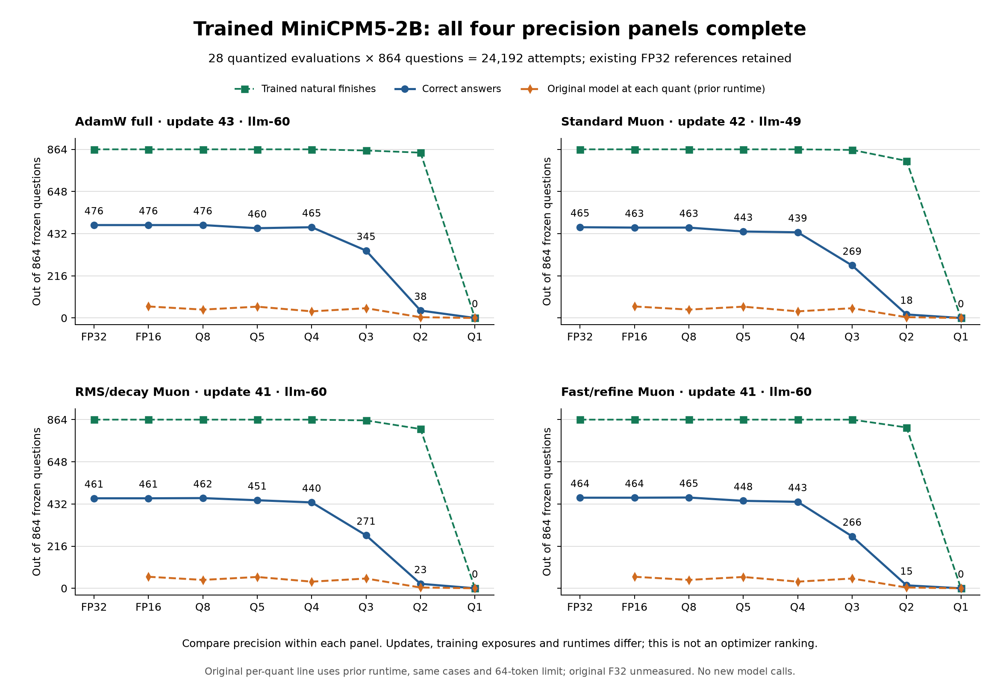
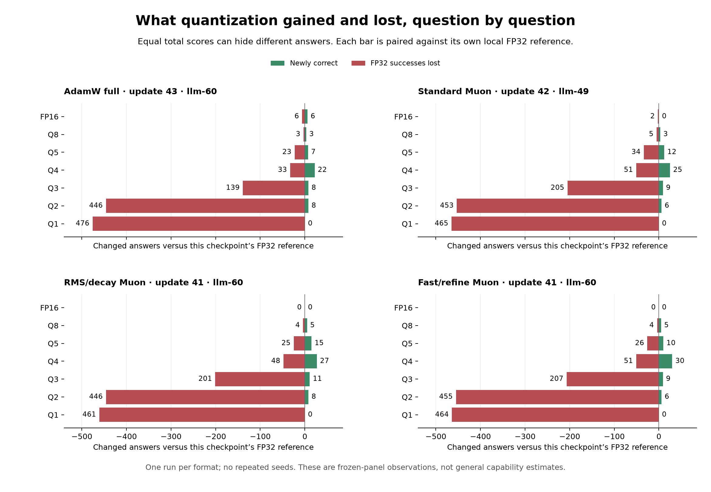

# Trained MiniCPM5-2B: four complete precision panels

**All four intermediate checkpoints completed all seven formats: 28 quantized
evaluations and 24,192 question attempts.** Each format faced the same 864-case
frozen panel with a 64-token response allowance through PCC/COW. FP32 references
are included separately; existing completed references were reused. The standard
Muon checkpoint received its required local FP32 reference on llm-49. No new
training or seed repetitions were performed for these precision sweeps.

Each panel now includes an **orange dashed original-model correctness curve**:
F16 59, Q8 43, Q5 58, Q4 34, Q3 50, Q2 4 and Q1 0. Original F32 remains
unmeasured. These are historical scores on the same 864 frozen cases through
a different runtime; the overlay is not a matched-runtime causal comparison.
The [original-model report](MINICPM-QUANTIZATION-PROGRESS.md) retains its receipts.

| Intermediate checkpoint | FP32 | FP16 | Q8 | Q5 | Q4 | Q3 | Q2 | Q1 |
| --- | ---: | ---: | ---: | ---: | ---: | ---: | ---: | ---: |
| Original model, prior runtime | not measured | 59 | 43 | 58 | 34 | 50 | 4 | 0 |
| AdamW full, update 43, llm-60 | 476 | 476 | 476 | 460 | 465 | 345 | 38 | 0 |
| Standard Muon, update 42, llm-49 | 465 | 463 | 463 | 443 | 439 | 269 | 18 | 0 |
| RMS/decay Muon, update 41, llm-60 | 461 | 461 | 462 | 451 | 440 | 271 | 23 | 0 |
| Fast/refine Muon, update 41, llm-60 | 464 | 464 | 465 | 448 | 443 | 266 | 15 | 0 |

Entries are correct answers out of 864, not percentages. Compare precision
**within a row**: these are different intermediate updates, training exposures
and runtimes, not a matched optimizer ranking. The A100 equal-exposure study is
separate and still unfinished.

The [32-row aggregate CSV](results/minicpm-20261026/trained-precision-panels.csv)
contains all four FP32 references, all 28 quantized measurements, natural
finishes, individual-answer gains/losses and exact model/runtime identities.
The [plot source](results/minicpm-20261026/plot_trained_precision_panels.py) and
[read-only collector](results/minicpm-20261026/collect_completed_panel.py)
are included. The original evidence was rechecked using S³'s paired validator;
the validation receipts retain original result, settlement and summary hashes:
[AdamW](results/minicpm-20261026/trained-quantization-validation.json),
[standard Muon](results/minicpm-20261026/trained-precision-muon42-validation.json),
[RMS/decay](results/minicpm-20261026/trained-precision-rms41-validation.json),
[fast/refine](results/minicpm-20261026/trained-precision-fast41-validation.json).
The three newly collected panels were validated on 2026-10-26 UTC. No protected
questions, responses or model files are published.

## What the new results mean

In plain language, shrinking these trained checkpoints to FP16 or Q8 kept nearly
the same total score. Q4/Q5 kept much of it. Q3 lost substantially more, and
Q2/Q1 performed poorly on this panel. This establishes a useful precision-retention
observation for these artifacts; it does not establish why a particular answer
changed or qualify a final model.

At a master's level, count paired transitions rather than only comparing totals.
For each precision, let G be questions that become correct relative to that
checkpoint's FP32 reference, and L be FP32 successes that become wrong. The net
score difference is G − L. For example, RMS/decay Q8 gains five and loses four;
its +1 total is a quantization-associated decoding change, not another training
improvement. Standard Muon FP16 loses two successes with no gains. Equal totals
can still conceal substantial changes in which questions succeed.

For research interpretation, parameter rounding changes the complete autoregressive
trajectory, including stopping. These are deterministic, single-run observations
under one frozen test panel and response bound, not an estimate of general model
capability or a controlled optimizer effect. No independent high-precision oracle
has isolated quantizer versus kernel versus decoding contributions. Q1's zero
natural finishes under the 64-token allowance must not be diagnosed as a specific
kernel defect from the score alone.

In practice, FP16/Q8 are the least disruptive tested storage choices for these
intermediate artifacts. Q4/Q5 offer a size/score tradeoff that still needs the
actual intended workflow tests. We retain the paired losses for later independent
practice-family design; the protected evaluation answers do not become lessons.

The native checkpoint histories remain separately labelled: AdamW 43 has 1,161
practice presentations, standard Muon 42 has 1,134, and the two update-41 variants
have 1,107 each. These are exposures, not that many distinct demonstrations.
The standard Muon inference runtime on llm-49 is
`08764412fc6f633b4b14b18a8f4f19bac7add741dcfa318266bd2f8986cbbe61`;
the other three use the llm-60 runtime documented below. A trained model moved
only over the home LAN for the llm-49 panel; no large model moved between home
and A100. Timing is not the organizing principle or the optimizer comparison.

## Original AdamW checkpoint detail

**All seven formats completed 864 frozen questions each.** This panel uses an
existing native full-weight AdamW checkpoint at update 43, with 1,161 practice
presentations. Its existing FP32 evaluation was reused as the reference; this
study performed no additional training. The presentations are training
exposures, not a claim of 1,161 distinct demonstrations.

| Format | Correct / 864 | Natural finishes / 864 | Newly correct vs FP32 | FP32 successes lost |
| --- | ---: | ---: | ---: | ---: |
| FP32 reference | 476 | 864 | 0 | 0 |
| FP16 | 476 | 864 | 6 | 6 |
| Q8_0 | 476 | 864 | 3 | 3 |
| Q5_K_M | 460 | 864 | 7 | 23 |
| Q4_K_M | 465 | 864 | 22 | 33 |
| Q3_K_M | 345 | 858 | 8 | 139 |
| Q2_K | 38 | 847 | 8 | 446 |
| Q1_0 | 0 | 0 | 0 | 476 |

[Aggregate data and identities](results/minicpm-20261026/trained-quantization-progress.csv)
and the [plot script](results/minicpm-20261026/plot_trained_quants.py) are included.
The [paired-validation receipt](results/minicpm-20261026/trained-quantization-validation.json)
records the exact original result/settlement/summary hashes and validator source.
The final collection was checked at 2026-10-26 05:37 UTC. No model files or
protected questions/answers are published.

## Plain-language reading

The question was whether shrinking a trained model would erase its improvement.
For this checkpoint and test, FP16 and Q8 kept the same total score as FP32.
Q4 and Q5 kept much of it. Q3 lost substantially more; Q2 and Q1 did poorly.

Matching totals do not mean matching answers. Q8 changed six answer outcomes:
three became correct and three previously correct answers became wrong. FP16
gained six and lost six. Q4 had a higher total than Q5 while losing more of the
FP32 model's earlier successes. This is why the learning loop records individual
gains and losses and carries regression families into later practice.

These measurements do not choose the final model or establish an optimizer
winner. This is one intermediate artifact. The separate A100 comparison still
needs to finish its equal-exposure 68-update trajectories.

## Technical reading

The source checkpoint has SHA-256
`050e75d6cca444068e77e88132e2a93f8e1d4e653472ee3c7e905382309cb5d9`.
Its original native training exit was zero; its independent reload mean-loss
error was approximately `2.62e-8`, below the existing `2e-4` bound. Its original
864-case FP32 evaluation was complete before the precision sweep.

The seven converted artifacts were evaluated on llm-60 through the existing
S³ evaluator and PCC shared-prefix COW path. Every result/settlement is complete
for 864 cases, and summary counts and model hashes match the original result.
S³'s paired validator checked unique case coverage, skill/gate membership,
aggregate counts, immutable evaluation flags and matched local runtime against
the FP32 reference. The common runtime identity is
`1d222d36424ce64b1989b5ed8750b2eda6e9030020de45f7adddb615a1168bdc`.
The response allowance remains 64 generated tokens.

This provides a within-checkpoint precision comparison. The
[original-model precision panel](MINICPM-QUANTIZATION-PROGRESS.md) ran on A100
using a different recorded execution path/runtime. It must not be silently
pooled with this panel as an otherwise identical experiment isolating the effect
of training. Each panel retains its own provenance. Neither measures general
BW tool ability or autonomous research performance.

One run per format was performed. There are no seed repetitions. The empirical
counts describe this frozen panel; they are not population-wide capability
estimates. Finite deterministic artifact execution is not an independent FP64
reference proof for every dequantized operation. A low score alone does not
diagnose a quantizer or kernel defect.

## Execution and independent work

The initial four-format inference launch encountered PCC's exclusive GPU lock:
Q8 acquired it, and six other attempts stopped at GPU admission with zero
completed cases and no COW model session. Those refusal records remain intact.
An explicit recovery reused the converted bytes and evaluated the remaining
formats sequentially. The failed admissions did not repeat question inference.
PCC's ownership lock was preserved.

The earlier extra llm-60 full-training trajectories were stopped and remain
excluded from the primary A100 training curves. Reusing their existing completed
artifacts for this new precision question avoids additional backpropagation.

The subsequently completed studies were the distinct RMS/decay Muon update-41
and fast/refine update-41 panels on llm-60, and standard Muon update-42 on llm-49,
including its local FP32 inference reference. The latter's trained source artifact
was copied directly over the LAN and hash-verified; no full model was transferred
between A100 and either home host. The different update counts/runtimes make
these exploratory precision-retention panels, not a matched optimizer ranking.

## Remaining work

### Planned follow-up: quantization-aware training for Q4 and below

The owner requested a later QAT study targeting **Q4, Q3, Q2 and Q1**. It is a
separate follow-up; this note does not change the frozen 68-update optimizer/rank
comparison or claim that a QAT run has started. The current sweeps quantize
already-trained weights afterward. They do not train with simulated quantization
error, and their poor low-bit scores do not establish that lack of QAT is the
sole cause.

The intended question is whether adapting to a particular deployment quantizer
recovers low-bit correctness, instruction following and natural stopping while
preserving previously learned skills. QAT must match the actual target format's
rounding, grouping/scales, tensor treatment and clipping behavior; success with
an unrelated generic low-bit simulation would not qualify these GGUF formats.
Support and numerical checks belong in PCC's native engine; S³ owns separate
practice, frozen measurements and learning/forgetting reports. BW exercises the
actual workflow and drives the existing service API. No PyTorch training path
is implied.

Start each comparison from the same preserved checkpoint. Compare QAT with an
ordinary-training control receiving the same additional practice presentations
and update count, then quantize both to the same target format. Retain a direct
post-training-quantized reference as well. Measure FP32/FP16/Q8 behavior after
the extra training to detect effects hidden by the low-bit score. Keep test
questions out of calibration and practice, record per-question gains/losses,
natural finishes, per-domain retention and intended BW workflow outcomes, and
report bytes and compute as measurements rather than a fixed training-time
stopping rule. The initial focus is Q4 and below; whether any particular format
can be recovered remains an experimental question.

[LLM-QAT](https://arxiv.org/abs/2305.17888) provides evidence that QAT can improve
low-precision LLM results. [QuIP](https://arxiv.org/abs/2307.13304) also demonstrates
viable two-bit post-training quantization with a different method. These support
testing QAT and quantizer choices; neither proves that QAT will rescue this
MiniCPM checkpoint in the specific formats measured here.

Finish the remaining A100 trajectories, retention
and sealed review, then the final selected-checkpoint precision/export decision.
The reusable verified BW lesson provider and native recovery path are published;
the production policy joining target skill, actual BW workflow and retention
panels remains unfinished. No model has been uploaded or broadly qualified by
this report.
