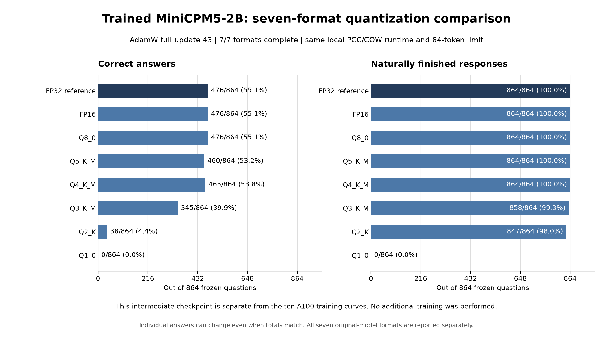

# Trained MiniCPM5-2B: the first complete precision panel

**All seven formats completed 864 frozen questions each.** This panel uses an
existing native full-weight AdamW checkpoint at update 43, with 1,161 practice
presentations. Its existing FP32 evaluation was reused as the reference; this
study performed no additional training. The presentations are training
exposures, not a claim of 1,161 distinct demonstrations.

| Format | Correct / 864 | Natural finishes / 864 | Newly correct vs FP32 | FP32 successes lost |
| --- | ---: | ---: | ---: | ---: |
| FP32 reference | 476 | 864 | 0 | 0 |
| FP16 | 476 | 864 | 6 | 6 |
| Q8_0 | 476 | 864 | 3 | 3 |
| Q5_K_M | 460 | 864 | 7 | 23 |
| Q4_K_M | 465 | 864 | 22 | 33 |
| Q3_K_M | 345 | 858 | 8 | 139 |
| Q2_K | 38 | 847 | 8 | 446 |
| Q1_0 | 0 | 0 | 0 | 476 |

[Aggregate data and identities](results/minicpm-20261026/trained-quantization-progress.csv)
and the [plot script](results/minicpm-20261026/plot_trained_quants.py) are included.
The [paired-validation receipt](results/minicpm-20261026/trained-quantization-validation.json)
records the exact original result/settlement/summary hashes and validator source.
The final collection was checked at 2026-10-26 05:37 UTC. No model files or
protected questions/answers are published.

## Plain-language reading

The question was whether shrinking a trained model would erase its improvement.
For this checkpoint and test, FP16 and Q8 kept the same total score as FP32.
Q4 and Q5 kept much of it. Q3 lost substantially more; Q2 and Q1 did poorly.

Matching totals do not mean matching answers. Q8 changed six answer outcomes:
three became correct and three previously correct answers became wrong. FP16
gained six and lost six. Q4 had a higher total than Q5 while losing more of the
FP32 model's earlier successes. This is why the learning loop records individual
gains and losses and carries regression families into later practice.

These measurements do not choose the final model or establish an optimizer
winner. This is one intermediate artifact. The separate A100 comparison still
needs to finish its equal-exposure 68-update trajectories.

## Technical reading

The source checkpoint has SHA-256
`050e75d6cca444068e77e88132e2a93f8e1d4e653472ee3c7e905382309cb5d9`.
Its original native training exit was zero; its independent reload mean-loss
error was approximately `2.62e-8`, below the existing `2e-4` bound. Its original
864-case FP32 evaluation was complete before the precision sweep.

The seven converted artifacts were evaluated on llm-60 through the existing
S³ evaluator and PCC shared-prefix COW path. Every result/settlement is complete
for 864 cases, and summary counts and model hashes match the original result.
S³'s paired validator checked unique case coverage, skill/gate membership,
aggregate counts, immutable evaluation flags and matched local runtime against
the FP32 reference. The common runtime identity is
`1d222d36424ce64b1989b5ed8750b2eda6e9030020de45f7adddb615a1168bdc`.
The response allowance remains 64 generated tokens.

This provides a within-checkpoint precision comparison. The
[original-model precision panel](MINICPM-QUANTIZATION-PROGRESS.md) ran on A100
using a different recorded execution path/runtime. It must not be silently
pooled with this panel as an otherwise identical experiment isolating the effect
of training. Each panel retains its own provenance. Neither measures general
BW tool ability or autonomous research performance.

One run per format was performed. There are no seed repetitions. The empirical
counts describe this frozen panel; they are not population-wide capability
estimates. Finite deterministic artifact execution is not an independent FP64
reference proof for every dequantized operation. A low score alone does not
diagnose a quantizer or kernel defect.

## Execution and independent work

The initial four-format inference launch encountered PCC's exclusive GPU lock:
Q8 acquired it, and six other attempts stopped at GPU admission with zero
completed cases and no COW model session. Those refusal records remain intact.
An explicit recovery reused the converted bytes and evaluated the remaining
formats sequentially. The failed admissions did not repeat question inference.
PCC's ownership lock was preserved.

The earlier extra llm-60 full-training trajectories were stopped and remain
excluded from the primary A100 training curves. Reusing their existing completed
artifacts for this new precision question avoids additional backpropagation.

At the next verified dispatch, llm-60 was running a distinct RMS/decay Muon
update-41 precision panel. llm-49 was running a distinct standard Muon update-42
panel, including a local FP32 inference reference. Its trained source artifact
was copied directly over the LAN and hash-verified; no full model was transferred
between A100 and either home host. The different update counts/runtimes make
these exploratory precision-retention panels, not a matched optimizer ranking.

## Remaining work

Finish the other active precision panels, the ten A100 trajectories, retention
and sealed review, then the final selected-checkpoint precision/export decision.
The reusable verified BW lesson provider and native recovery path are published;
the production policy joining target skill, actual BW workflow and retention
panels remains unfinished. No model has been uploaded or broadly qualified by
this report.
