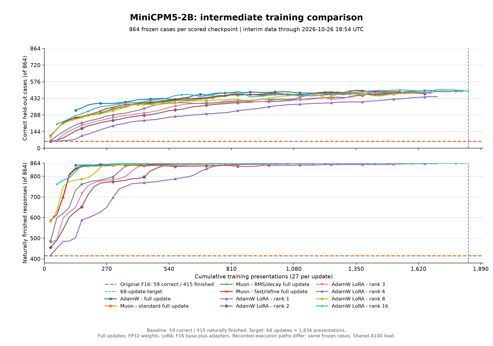
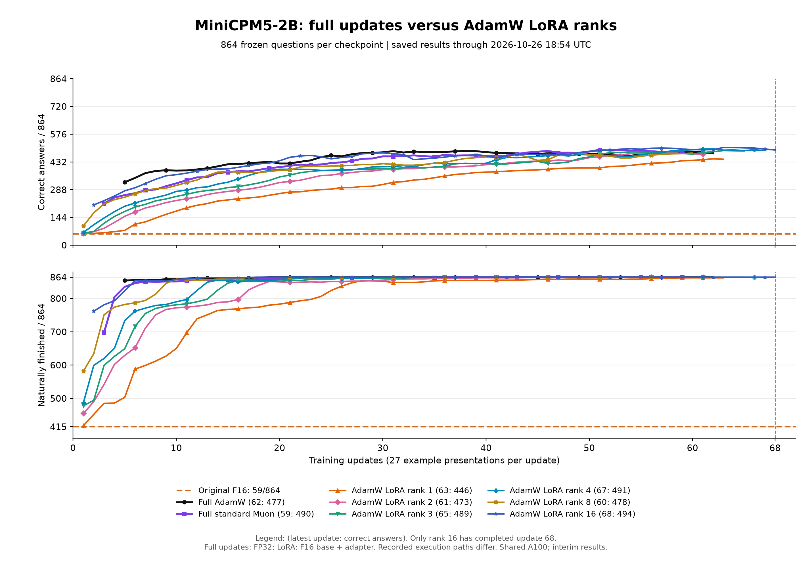
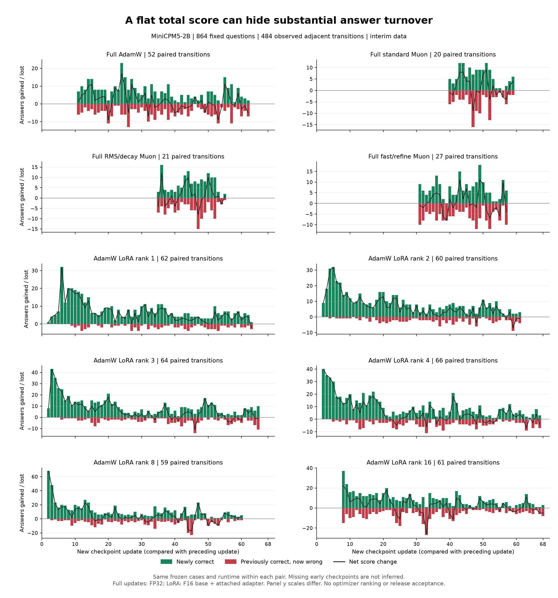
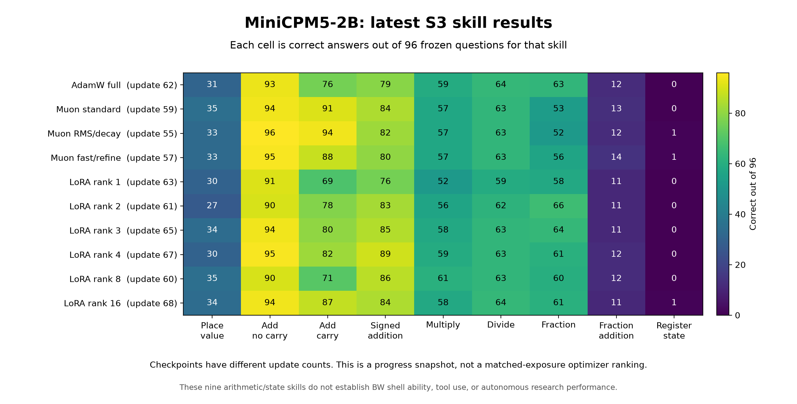

# MiniCPM update-curve progress snapshot

## Current chart: all ten trajectories, receipts collected at 19:02 UTC

The orange dashed reference is the original F16 model: **59/864 correct**
and **415/864 naturally finished**. It is a historical reference; recorded
execution paths differ from some trained arms. Quantization charts also show
the original model at each measured quant size.

The chart contains 610 completed scored checkpoints, 8 more than the preceding
snapshot. It includes full AdamW, standard Muon, RMS/decay Muon, fast/refine
Muon, and all six AdamW LoRA ranks. Full updates use FP32 weights; LoRA uses
the F16 base with its attached adapter. All rows use the same 864 frozen
questions; recorded execution paths differ. Only rank 16 has finished 68 updates.
This remains an interim comparison, not a final optimizer or rank ranking.

### Requested comparison: standard optimizers and six LoRA ranks

Both charts use completed measurements only. Lines end where assessment has
actually finished; unfinished arms are not extrapolated to update 68.
The [rank-chart source](results/minicpm-20261026/plot_rank_comparison.py) and
[all-point CSV](results/minicpm-20261026/intermediate-training-curves.csv) are included.

| Arm | Latest update / 68 | Correct / 864 | Natural finishes / 864 |
| --- | ---: | ---: | ---: |
| Full AdamW | 62 | 477 | 864 |
| Full standard Muon | 59 | 490 | 864 |
| Full RMS/decay Muon | 55 | 490 | 864 |
| Full fast/refine Muon | 57 | 487 | 864 |
| AdamW LoRA rank 1 | 63 | 446 | 862 |
| AdamW LoRA rank 2 | 61 | 473 | 864 |
| AdamW LoRA rank 3 | 65 | 489 | 864 |
| AdamW LoRA rank 4 | 67 | 491 | 864 |
| AdamW LoRA rank 8 | 60 | 478 | 864 |
| AdamW LoRA rank 16 | 68 | 494 | 864 |

The original baseline was 59 correct and 415 natural finishes. This collection
checked 502 current saved points against complete result and settlement
receipts; older preserved history remains in the CSV. Overlapping counts,
runtime identities and result hashes were checked before merging.
The [validation receipt](results/minicpm-20261026/training-curves-validation-1902.json)
retains point/result/settlement hashes. Rank 8 update 34 uses the explicit,
previously validated recovery reduction: 227 preserved completed cases plus
637 missing cases, with disjoint coverage of all 864. Its original assessment
failed with CUDA out of memory; no completed case or training update was repeated.
The resumed arm has completed updates 35 through 60. Recovery is not a seed repeat.

Four rank workers (1, 2, 3, 4) voluntarily stopped after a complete checkpoint,
then resumed at its successor with exact saved optimizer state and exposure cursor.
Their previous 50-percent utilization filter is removed. GPU placement now depends
on free VRAM and the existing ownership locks; evaluation retains additional VRAM
headroom against shared-load spikes. Numerical profiles and the 864 questions are
unchanged. Six copied checkpoint references were verified against the original
receipts and not counted as new measurements or assigned new score timestamps.

No training or inference was repeated to make these charts. Earlier RMS/decay
and fast/refine completion timestamps absent from preserved history remain blank.
Shared A100 wall-clock timings are not reliable isolated throughput comparisons;
training presentations and updates organize this study. Four superseded model/state
pairs were preserved and byte-verified on the A100's persistent disk before their
RAM copies were retired, reclaiming about 83 GiB.

At the next storage check, the server still had about 2 TB of ordinary disk
space free, while its shared RAM workspace was short of unreserved headroom.
Old completed COW stores had accumulated beyond the existing model/state
cleanup. Two verified maintenance passes retired 248 closed stores from that
RAM workspace, reclaiming 172,450,432,845 bytes (about 160.6 GiB). Each store's
disk archive and individual file hashes were checked before retirement. Models,
optimizer states, raw case responses and evaluation scores were preserved.
The existing controllers continued; no completed training or inference was
repeated for cleanup. A bounded maintenance worker now applies the same archival
checks regularly, retaining the latest three checkpoints in each group. Its
[implementation and qualification](https://github.com/CC-David-CC/Private_Context_COW/blob/feat/closed-store-retention-20261026/docs/CLOSED-STORE-RETENTION.md)
include 13 CPU controls and an independent content audit of all 248 archives.
The worker does not delete models, optimizer states, response evidence or scores.

### What changed underneath the total score?

Four CPU analysis processes compared 492 adjacent completed checkpoint pairs,
requiring the same 864 case identities and runtime within each pair. Of those,
440 both gained correct answers and lost previously correct answers. For example,
full AdamW stayed at **481/864 from update 56 to 57**, while gaining 11 answers
and losing 11 others. A flat total did not mean unchanged behavior.

Green bars show newly correct answers, red bars show losses, and the black line
shows their net difference. These are changes from the **immediately preceding
update**, not cumulative gains against the original model. Missing early raw
checkpoints are not invented. Individual panel y scales differ. The analysis
used existing receipts and dispatched no training or inference.

The [paired CSV](results/minicpm-20261026/paired-update-transitions.csv),
[per-skill/gate counts and receipt hashes](results/minicpm-20261026/paired-update-transitions.json),
and [plot source](results/minicpm-20261026/plot_update_turnover.py) accompany the
figure. The available pairs cover different update ranges, so their counts do
not rank optimizers or LoRA ranks. This is development answer turnover; it does
not establish broad forgetting, a mechanism, or release acceptance. The fixed
68-update questions remain unchanged.

### Placement follow-up after this score snapshot

The three Muon controllers had been waiting for 70 GiB free, although PCC's
completed memory plans and graph-allocation receipts supported smaller windows.
Each exact idle owner was retired only after proving that its next native update
had not started. Its completed weights, moments, exposure cursor and assessment
were retained; seed assessments were referenced, never rerun.

Their successors forecast placement from PCC's persistent/scratch/reserve
admission estimate plus observed graph peaks. The initial forecast was about
38.3 GiB for these requests; it is not a new universal VRAM minimum. The native
allocator still checks the actual free memory and each graph before allocation.
Compute utilization is not capped. Standard Muon has completed native update 60
and its reload check; its next full-panel score is not included until settled.
Other variants continue independently. No optimizer settings, examples, native
binary or frozen test cases changed during this scheduling correction.

### Which S³ skills are actually being measured?

Each cell is correct answers out of 96 questions. This panel covers eight
arithmetic skills and register-state tracking. The
[skill CSV](results/minicpm-20261026/latest-skill-scores.csv) and
[plot script](results/minicpm-20261026/plot_skill_scores.py) retain exact counts.
Register-state scores are zero in 7 of ten rows; the latest values range
from 0 to 1 correct answers out of 96. The cause of each failure family still needs investigation; zero on
this panel does not establish that a model cannot learn state tracking.
These measurements do not qualify BW shell tasks, tool use, or research agency.
Those require their own workflow panels in the reusable learning policy.

### Trained quantization is now measured too

The separate [four-checkpoint precision report](MINICPM-TRAINED-QUANTIZATION.md)
now contains all seven formats for intermediate AdamW, standard Muon, RMS/decay
and fast/refine checkpoints: 28 completed quantized evaluations, 864 questions
each. It includes total scores, natural finishes and paired gains/losses. Existing
trained artifacts were reused without new training or A100 model transfer. These
unequal intermediate checkpoints are separate from the ten trajectories above.

Older timestamped snapshots below remain historical records. The current
tables and linked precision reports supersede their status statements.

**Precision results are now reconciled:** [all seven original-model formats
completed the 864-question panel](MINICPM-QUANTIZATION-PROGRESS.md), with a chart,
aggregate CSV and explicit measurement limits. Earlier statements below that
the entire quantization matrix had not started were wrong for the original-model
half. Precision testing of the final selected 68-update checkpoints is still
pending; the four intermediate trained precision panels are complete.

Initial capture: 2026-10-26 01:53-01:54 UTC. This is an interim results note, not an acceptance report. Time-stamped refreshes below update the saved progress as work continues.

## Live status refresh — 2026-10-26 02:03 UTC

- **A100 is reachable.** An 8-GPU `nvidia-smi` snapshot returned at 02:03:50 UTC. The exact per-arm score table below remains the latest verified A100 completion table; no newer A100 evaluation receipt was confirmed during this refresh. A100 resource records at 01:57 show several jobs waiting for GPU admission. The snapshot also showed heavy shared load on GPUs 3, 4 and 5 (100%, 98% and 97% utilization), so waiting is consistent with contention. No A100 study crash was confirmed.
- **llm-60 is still working.** At 02:02 UTC, its COW evaluator was evaluating AdamW full update 40. The latest completed receipts remain AdamW update 39 (488/864) and standard Muon, RMS/decay Muon and fast/refine Muon at update 38. The RTX PRO 6000 showed about 90% utilization with 9.7 GiB occupied in that snapshot. This is active evaluation, not a stuck training process.
- **No model has been accepted or promoted.** Both the fixed comparison and rank sweep are incomplete. This refresh adds machine/process observations, not new model scores.

## Latest verified checkpoints — 2026-10-26 02:11 UTC

These are the newest saved per-arm progress records I could verify. A100's progress files were current through 02:01-02:03; llm-60's newest completed evaluation was AdamW update 40. The current numbers below replace the 01:54/01:53 snapshot tables that follow; those earlier tables remain to show what was known at that time.

### Original fixed-68 comparison

| Host | Arm | Latest complete update / 68 | Example presentations | Correct / 864 |
| --- | --- | ---: | ---: | ---: |
| A100 | Full AdamW | 44 | 1,188 | 474 (54.9%) |
| A100 | Full standard Muon | 46 | 1,242 | 489 (56.6%) |
| A100 | Full RMS/decay Muon | 44 | 1,188 | 482 (55.8%) |
| A100 | Full fast/refine Muon | 41 | 1,107 | 464 (53.7%) |
| A100 | AdamW LoRA rank 16 | 55 | 1,485 | 498 (57.6%) |
| llm-60 | Full AdamW | 40 | 1,080 | 483 (55.9%) |
| llm-60 | Full standard Muon | 38 | 1,026 | 466 (53.9%) |
| llm-60 | Full RMS/decay Muon | 38 | 1,026 | 464 (53.7%) |
| llm-60 | Full fast/refine Muon | 38 | 1,026 | 478 (55.3%) |

The next saved llm-60 score is actively being evaluated: standard Muon update 39. On A100, several arms have recent `waiting-resource` records, so a saved score can lag behind the live GPU snapshot. A100 and llm-60 are separate runs, not repeat seeds, and their scores must not be pooled as repeats.

Some checkpoints moved down on the same 864-case suite: A100 LoRA16 went from 501 at update 54 to 498 at update 55; A100 fast/refine Muon went from 466 at update 40 to 464 at update 41; llm-60 AdamW went from 488 at update 39 to 483 at update 40. These are score decreases, not crashed processes. Per-case gains and losses are needed to explain what changed.

### Extended LoRA-rank sweep on A100

| LoRA rank | Latest complete update | Example presentations | Correct / 864 | Naturally finished / 864 |
| ---: | ---: | ---: | ---: | ---: |
| 1 | 12 | 324 | 207 (24.0%) | 739 |
| 2 | 16 | 432 | 285 (33.0%) | 797 |
| 3 | 14 | 378 | 289 (33.4%) | 825 |
| 4 | 14 | 378 | 317 (36.7%) | 855 |
| 8 | 18 | 486 | 376 (43.5%) | 863 |

These are still early and uneven practice counts; they do not yet establish the best rank. The sweep remains separate from the fixed 68-update comparison.

At about 02:11 UTC, the shared A100 snapshot showed 98% utilization on GPU 0, 100% on GPU 3 and 97% on GPU 4. Several arms had entered `waiting-resource` states. On llm-60, the RTX PRO 6000 was evaluating with about 9.3 GiB occupied; the latest snapshot showed 34% utilization. No training candidate has been accepted or promoted.

## What was measured

The model is MiniCPM5-2B. Each score below is the number of correct cases out of the same 864-case held-out set. Training progress is reported in updates and example presentations, not wall-clock time. Each update contains 27 presentations. The historical starting model scored 59/864 (6.8%) and naturally finished 415/864 responses on this suite.

The original comparison has five arms, each planned for 68 updates: full-weight AdamW, standard full-weight Muon, RMS/decay Muon, fast/refine Muon, and AdamW LoRA rank 16. A100 and llm-60 are separate run roots. No full model checkpoints were transferred between them. llm-60 carries the four full-weight optimizer arms; the LoRA and rank sweep are on A100.

## Original fixed-68 comparison: historical 01:53-01:54 checkpoints

### A100 (01:54 snapshot)

| Arm | Latest complete update / 68 | Example presentations | Correct / 864 |
| --- | ---: | ---: | ---: |
| Full AdamW | 44 / 68 | 1,188 | 474 (54.9%) |
| Full standard Muon | 46 / 68 | 1,242 | 489 (56.6%) |
| Full RMS/decay Muon | 44 / 68 | 1,188 | 482 (55.8%) |
| Full fast/refine Muon | 40 / 68 | 1,080 | 466 (53.9%) |
| AdamW LoRA rank 16 | 54 / 68 | 1,458 | 501 (58.0%) |

### llm-60 (01:53 snapshot)

| Arm | Latest complete update / 68 | Example presentations | Correct / 864 |
| --- | ---: | ---: | ---: |
| Full AdamW | 39 / 68 | 1,053 | 488 (56.5%) |
| Full standard Muon | 38 / 68 | 1,026 | 466 (53.9%) |
| Full RMS/decay Muon | 38 / 68 | 1,026 | 464 (53.7%) |
| Full fast/refine Muon | 37 / 68 | 999 | 478 (55.3%) |

These are intermediate checkpoints at unequal update counts, so they do not identify a winning optimizer. In particular, the A100 and llm-60 scores are not pooled as if they were repeats of one identical run. No candidate has been promoted.

At 01:53 UTC, llm-60 AdamW update 39 had a complete held-out score. A Muon fast/refine update 38 native training step was active at 01:49 UTC, and one held-out evaluator was active at 01:53 UTC. The other llm-60 arms remain below update 39; their controllers are separate from the A100 jobs.

## Extended LoRA-rank sweep on A100 (01:54 snapshot)

These rank arms were added after the original five-arm plan. Each point below is an independently completed 864-case evaluation, but the ranks have seen different numbers of updates and presentations. Do not read the table as a controlled rank leaderboard.

| LoRA rank | Latest complete update | Example presentations | Correct / 864 | Naturally finished / 864 |
| ---: | ---: | ---: | ---: | ---: |
| 1 | 12 | 324 | 207 (24.0%) | 739 |
| 2 | 15 | 405 | 279 (32.3%) | 790 |
| 3 | 13 | 351 | 284 (32.9%) | 798 |
| 4 | 14 | 378 | 317 (36.7%) | 855 |
| 8 | 17 | 459 | 378 (43.8%) | 863 |

Rank 1 and 2 had substantially more non-finishing answers at these early checkpoints. More updates and matched-presentation comparisons are needed before drawing a capacity conclusion.

## What is running and resource limits

The 01:47 UTC census found all ten A100 study owners alive. At 01:54 UTC, three evaluation workers and four native training workers were active on A100. At 01:53 UTC, one held-out evaluator was active on llm-60. No arm failure or lost owner was reported. This is a live-process snapshot; an arm between evaluations may be waiting for its next admitted step.

A100 GPU utilization and free VRAM in one shared-load sample at 01:49 UTC:

| GPU | Utilization | Free VRAM |
| ---: | ---: | ---: |
| 0 | 51% | 59.1 GiB |
| 1 | 7% | 38.6 GiB |
| 2 | 0% | 73.9 GiB |
| 3 | 100% | 28.7 GiB |
| 4 | 28% | 13.7 GiB |
| 5 | 11% | 52.6 GiB |
| 6 | 32% | 24.6 GiB |
| 7 | 26% | 58.2 GiB |

This is a point-in-time shared-server observation at 01:49 UTC. GPU timings are not used to rank the arms and may be affected by other users' jobs. The A100 host reported about 215 GiB free in its shared-memory filesystem and about 2.3 TiB free in the study home mount. llm-60 reported about 126 GiB free in its home filesystem and about 10% utilization on its single GPU during the active Muon fast/refine training step. These are capacity observations, not proof that every arm can claim those resources.

## Current interpretation and next gates (updated 02:11 UTC)

- The 68-update comparison is incomplete on both hosts. Latest verified A100 checkpoints span updates 41-55; llm-60 spans updates 38-40. One llm-60 evaluation and multiple A100 resource waits were observed during the 02:03-02:11 checks.
- The rank sweep is incomplete and has unequal practice counts. Latest verified points span updates 12-18. Compare ranks at matched presentations after collecting more updates.
- Preserve the answer-level gains and losses at every update. A higher aggregate score alone is not enough to accept a candidate if it forgets protected skills.
- Finish evaluation, settlement, and exact artifact checks before making a model-acceptance or export decision.

The hash-pinned per-run receipts and private machine/process inventory are retained separately. This public note intentionally contains aggregate results only.

## Live status refresh - 2026-10-26 02:37 UTC

- **No experiment crash was confirmed.** Both llm-60 and the A100 answered live read-only checks. On llm-60, the Muon RMS/decay evaluator exited after saving its update-39 result; this was a completed evaluation, not a lost run. A newer AdamW update-41 evaluator is now active and has not yet saved a score.
- **llm-60 latest completed checkpoints:** Full AdamW update 40, 483/864; standard Muon update 39, 465/864; RMS/decay Muon update 39, 465/864; fast/refine Muon update 38, 472/864. The new RMS/decay receipt records 427 original answers gained and 21 lost. No candidate was promoted.
- **A100 fixed comparison:** AdamW has now completed update 45 at 473/864, down one from update 44. Standard Muon remains at update 46 (489/864), RMS/decay Muon at update 44 (482/864), fast/refine Muon at update 41 (464/864), and LoRA16 at update 55 (498/864). Newer update directories exist for some arms but have no verified completed score yet. No candidate was promoted.
- **A100 rank extension:** the newest completed receipts I read at 02:35 include rank 2 at update 16 (285/864), rank 3 at update 14 (289/864), rank 4 at update 15 (327/864) and rank 8 at update 19 (383/864). Rank 1 remains at its earlier update-12 point (207/864). These have uneven practice counts; rank 4 rose from 317 and rank 8 rose from 376. This is not a controlled rank ranking.
- **Shared resources remain the pacing limit.** At 02:37, A100 utilization/free VRAM on the approved cards was GPU 0: 78%/62.7 GiB, GPU 1: 0%/38.3 GiB, GPU 2: 0%/74.9 GiB, GPU 4: 44%/13.3 GiB, GPU 5: 11%/58.6 GiB and GPU 7: 41%/61.5 GiB. GPU 3 and 6 were not assigned to this work. The A100 showed about 273 GiB free in `/dev/shm` and 2.3 TiB free on the study home mount, while some arm admission records still reported insufficient unreserved working-storage headroom. On llm-60, the home filesystem was 95% used with about 91 GiB free; its live AdamW evaluator used about 9.3 GiB of VRAM at 26% utilization.
- **Separate SSS/BW recovery machinery:** the CPU-only capture bridge passed one real BW ledger/capture fixture, three S³ code-check tests and six isolated Linux code cases. It independently confirmed one failure and its correction, then issued a sanitized receipt. It created no training lesson and dispatched no update. See the [qualification record](../validation/learning-program-20261024/bw-capture-oracle-machinery.json).
- **Still outstanding:** all fixed-comparison arms must reach update 68; LoRA ranks need more matched presentations; then the full per-update learning/forgetting graph and acceptance report can be finalized. The approved RoPE/YaRN position-extension branch has not started. No quantized release model or GGUF has been accepted.

This is a partial checkpoint, not an acceptance report. GPU utilization and timing are shared-host observations, not optimizer comparisons.

## Live status refresh — 2026-10-26 02:49 UTC

This refresh combines the llm-60 supervisor's saved score records with live A100 process and GPU snapshots through 02:48 UTC. No experiment crash is confirmed. A slow A100 process/filesystem inventory was interrupted after it stopped returning output; the run processes and jobs were not interrupted.

### Latest verified fixed-comparison results

| Host | Arm | Latest scored update / 68 | Presentations | Correct / 864 | Gained / lost vs. original |
| --- | --- | ---: | ---: | ---: | ---: |
| A100 | Full AdamW | 45 | 1,215 | 473 (54.7%) | latest per-case delta not refreshed |
| A100 | Full standard Muon | 46 | 1,242 | 489 (56.6%) | latest per-case delta not refreshed |
| A100 | Full RMS/decay Muon | 44 | 1,188 | 482 (55.8%) | latest per-case delta not refreshed |
| A100 | Full fast/refine Muon | 41 | 1,107 | 464 (53.7%) | latest per-case delta not refreshed |
| A100 | AdamW LoRA rank 16 | 55 | 1,485 | 498 (57.6%) | latest per-case delta not refreshed |
| llm-60 | Full AdamW | 41 | 1,107 | 479 (55.4%) | 434 / 14 |
| llm-60 | Full standard Muon | 40 | 1,080 | 464 (53.7%) | 427 / 22 |
| llm-60 | Full RMS/decay Muon | 39 | 1,053 | 465 (53.8%) | 427 / 21 |
| llm-60 | Full fast/refine Muon | 39 | 1,053 | 464 (53.7%) | 428 / 23 |

The llm-60 results are newer than the prior 02:37 table. AdamW moved from 483 at update 40 to 479 at update 41; standard Muon moved from 465 at update 39 to 464 at update 40; fast/refine Muon advanced from update 38 to 39 and scored 464. These are measured changes on the same 864-case set, not process failures. Scores are still at different update counts, so this is not a final optimizer ranking. No candidate was promoted.

### In flight and waiting

- **llm-60:** the study controller was alive at 02:48 UTC. RMS/decay Muon update 40's native training command exited with code 0 and left a candidate GGUF and optimizer state. Its held-out score had not appeared in the supervisor log by 02:48, and the GPU was idle at that instant. This is a completed training step awaiting evaluation/controller follow-through, not a confirmed crash.
- **A100:** the host was reachable at 02:48 UTC. Six study evaluation processes were visible: standard Muon update 47, RMS/decay Muon update 45, and LoRA ranks 2/19, 3/16, 4/17 and 8/21. Their result files were not yet present in the checked output locations at that snapshot, so the completed-score table above remains the latest verified one. No active rank-1 evaluator was visible; its last verified point remains update 12 (207/864). The absence of a visible evaluator does not establish that its controller crashed.
- At the same A100 snapshot, approved GPUs 0, 1, 2, 4, 5 and 7 showed 97%, 16%, 4%, 31%, 13% and 12% utilization respectively. GPUs 3 and 6 were at 100% and 97% and were not assigned to this study. This is shared-host telemetry, not a study-only utilization measurement.

### Extended work and remaining gates

- The rank sweep's last verified completed points remain rank 1: update 12, 207/864; rank 2: update 16, 285/864; rank 3: update 14, 289/864; rank 4: update 15, 327/864; rank 8: update 19, 383/864. Newer evaluations for ranks 2, 3, 4 and 8 were in flight, so do not treat those unequal practice counts as a rank leaderboard.
- The fixed five-arm comparison remains incomplete: every arm must reach update 68 and its held-out evaluation must settle. The per-update answer-level gain/loss graph and acceptance report are still outstanding.
- The approved RoPE/YaRN extension has not started. No quantized candidate has been accepted or exported.
- The CPU capture-to-oracle bridge remains a limited qualification: it verifies one captured failure/correction pair and issues a receipt, but it does not yet create an approved lesson or dispatch training. The complete reusable failure → verified lesson → train → learning/forgetting gate → accept/reject loop, and the BW shell-failure diagnosis, remain unfinished.

This is an interim progress record. The hosts, resource availability and pending evaluations must be checked again before interpreting any later result.

## Incremental result — 2026-10-26 02:52 UTC

- The A100 LoRA rank-3 arm completed update 16: **304/864 correct (35.2%)** and **854/864 naturally finished** after 432 presentations. At update 14 it had 289 correct and 825 naturally finished, so this checkpoint gained 15 correct answers and 29 natural completions. This is one within-run improvement, not a matched rank comparison.
- At 02:51 UTC, A100 held-out evaluations were still active for full standard Muon update 47, full RMS/decay Muon update 45, AdamW LoRA rank 16 update 58, and LoRA ranks 2/19, 4/17 and 8/21. Their result files were pending in the checked locations. Rank 3 update 16 is now complete; the other completed A100 fixed-comparison scores remain as listed above.
- llm-60 advanced from successful RMS/decay update-40 training into the COW held-out evaluator. The evaluator was live at 02:51 UTC; its score had not yet been saved. This confirms the earlier candidate was not stranded after training.

The original comparison is still unfinished, no arm is accepted, and no export has been made.

## New saved results — 2026-10-26 02:54 UTC

- **llm-60 RMS/decay Muon update 40** completed its COW held-out evaluation: 461/864 correct (53.4%), with 424 original answers gained and 22 lost. That is four fewer correct answers than update 39 (465/864), a measured score change rather than a crash. The study controller then started training fast/refine Muon update 40; its native training process was live at 02:53 UTC.
- **A100 AdamW LoRA rank 8 update 21** completed at 390/864 correct (45.1%) with 863/864 natural finishes. Compared with its last saved update 19 (383 correct, 863 finished), it gained seven correct answers and held natural finishes steady.
- At 02:53 UTC, A100 result files were still pending for full standard Muon update 47, full RMS/decay Muon update 45, LoRA rank 2 update 19, rank 4 update 17 and LoRA rank 16 update 58. Rank 3 update 16 and rank 8 update 21 now have completed scores.
- A separate **rank-1 update-15 training step** was also active under the native out-product qualification build. It uses the `lora-rank1-cuda-bf02` run directory; keep it separate from the original rank-extension curve until its run manifest and evaluation protocol are checked for equivalence.

No candidate has been promoted. The fixed 68-update comparison and the reusable failure-to-lesson training pathway remain incomplete.

## Live status refresh - 2026-10-26 04:21 UTC

This refresh replaces older progress snapshots above for the current arm scores. It uses completed aggregate evaluation receipts only; no held-out questions or model responses are included.

### Intermediate graph

The [intermediate graph](results/minicpm-20261026/intermediate-training-curves.png) shows all six AdamW LoRA ranks against full-update AdamW and standard full-update Muon. The x-axis is cumulative training presentations (27 per update); each point is a completed evaluation of the same 864 held-out cases. The dotted horizontal lines show the original MiniCPM baseline, and the vertical marker is the 68-update target. The graph now includes completed receipts through 04:20 UTC. Five LoRA arms advanced; rank 16 moved from 496 to 495 correct, a small regression that remains visible in the curve.

The [sanitized per-update CSV](results/minicpm-20261026/intermediate-training-curves.csv) and [plot script](results/minicpm-20261026/plot_curves.py) are included so the graph can be regenerated. The chart is explicitly interim and is not an acceptance decision.

### Latest completed A100 checkpoints

| Arm | Updates / 68 | Presentations | Correct / 864 | Naturally finished / 864 |
| --- | ---: | ---: | ---: | ---: |
| Full AdamW | 46 | 1,242 | 477 | 864 |
| Full standard Muon | 47 | 1,269 | 480 | 864 |
| Full RMS/decay Muon | 45 | 1,215 | 483 | 864 |
| Full fast/refine Muon | 42 | 1,134 | 465 | 864 |
| AdamW LoRA rank 1 | 18 | 486 | 250 | 774 |
| AdamW LoRA rank 2 | 23 | 621 | 349 | 850 |
| AdamW LoRA rank 3 | 19 | 513 | 336 | 852 |
| AdamW LoRA rank 4 | 21 | 567 | 394 | 859 |
| AdamW LoRA rank 8 | 25 | 675 | 411 | 863 |
| AdamW LoRA rank 16 | 61 | 1,647 | 495 | 864 |

The historical original-model baseline is 59/864 correct and 415/864 naturally finished. These curves show progress at different update counts; they are not a final rank leaderboard. Each candidate still needs to reach update 68 and pass the learning/retention review.

### Arm ownership and repeat control

- The last full controller census (04:14 UTC) found one controller for each of the ten unique arms listed above. At 04:21 UTC A100 was reachable; I observed a COW evaluation for RMS/decay Muon update 46 and a training step for fast/refine Muon update 43. I have not repeated the full ten-controller census since 04:14.
- Four full-update optimizer arms were also started on llm-60 before the duplicate-work audit. That runner has been stopped. Its partial records are preserved for audit but excluded from the primary curves and are not treated as seed repeats.
- The rank-1 curve now runs from the PCC size-one fix. Its earlier failed attempt used a stale pre-fix executable and is not counted. PCC PR #1 contains the fix and credits llama.cpp PR #30142.
- No candidate is accepted or promoted. No GGUF was exported.

### Remaining work and timing

1. Finish all ten single trajectories through 68 updates, saving and evaluating each checkpoint once.
2. Review per-case gains and losses, then run the larger 96-case peak checks and regression review before accepting a candidate.
3. Compare the selected trained candidate at FP16 and Q1/Q2/Q3/Q4/Q5/Q8 against the completed original-model results. The original seven-format half is complete; the trained half is pending and the current curve ETA does not include it.
4. Preserve a named GGUF only if the final measured result improves and survives the quantized checks.

Using the median duration of the last four completed update intervals for each arm gives a rough 20-22 hours for all ten 68-update curves to finish, assuming the controllers keep advancing and shared A100 load stays similar. Estimated remaining time by arm: full AdamW 17.7h; standard Muon 20.7h; RMS/decay Muon 16.0h; fast/refine Muon 13.4h; LoRA ranks 1/2/3/4/8/16 about 19.3/16.3/17.4/16.4/14.7/2.8h. Standard Muon currently sets the finish estimate. This is a rough forecast for the fixed comparison only; the 96-case peak checks, quantization matrix, and final acceptance review remain additional work.
