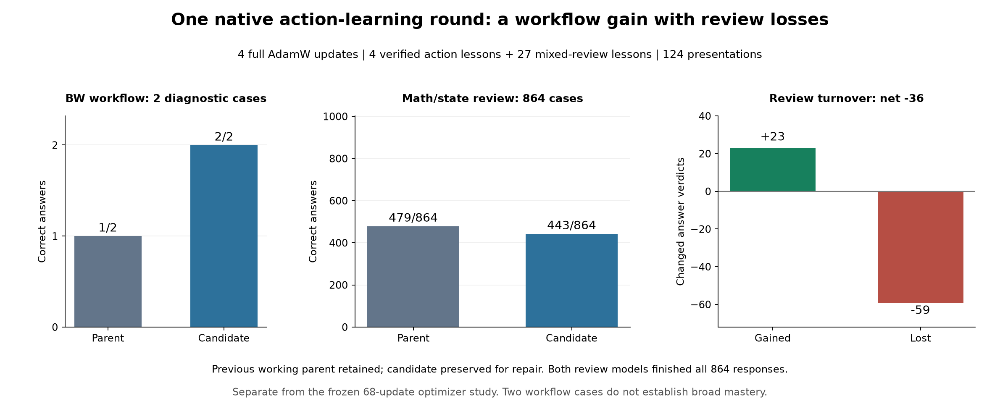

# A verified action lesson reached native training, testing and a saved model

One MiniCPM5-2B round completed the supported BW/PCC/S³ path: capture a checked
correction, render the actual tool actions, train with mixed review, test a new
candidate, record its decision and preserve a named private GGUF. An independent
saved-evidence audit then revalidated 1,736 case records without another model
call or training update.

The result is a tradeoff. The two-case BW workflow panel improved **1/2 → 2/2**;
arithmetic/state review fell **479 → 443 out of 864**. The installed policy kept
the previous working parent. The new candidate remains available for follow-up
practice as `MiniCPM-S3-action-block01-full-F32`; it has not been published as
weights or accepted for general use.

This is a **separate four-update experiment**, not another arm, continuation or
replacement of the frozen 68-update optimizer/rank study. Its starting point
was an already-trained local model. The 868-case aggregate baseline of 482
passes is coincidentally the same number as a different experiment's full
AdamW final score; those models and evaluations are not interchangeable.

| Panel | Before training | After training | Natural finishes, before → after |
| --- | ---: | ---: | ---: |
| Artifact target, diagnostic | 2/2 | 2/2 | 2 → 2 |
| BW workflow, diagnostic | 1/2 | 2/2 | 1 → 2 |
| Arithmetic/state review, nine skills | 479/864 | 443/864 | 864 → 864 |
| Raw aggregate used by the installed policy | 482/868 | 447/868 | 867 → 868 |

The two workflow cases are evidence of a working path and a particular observed
improvement. They do not establish a general tool-use failure rate or admin
mastery. Review has 96 cases per skill, divided into 32 independent,
32 composition and 32 transfer/recovery cases; those counts alone also do not
make its development distribution a universal capability measure.

## ELI5

We taught the model some checked examples of how to do a job with tools. It did
better on our two little job tests, but forgot some things on its math review.
We wrote down both results and kept both model versions. Next we can practice
the weak areas while checking that the new tool behavior survives.

The software also proved it can save the trained model, reload it accurately,
and leave enough records to check what happened after the run has stopped.

## Master's level

The recipe used ordinary, full end-to-end AdamW backpropagation in PCC's native
engine: four updates at learning rate `1e-6`, fresh optimizer moments, and a
31-example batch consisting of four verified tool-action examples plus 27
review examples covering every review skill/gate. This consumed 124 practice
presentations. There was no fixed training-time budget, PyTorch execution,
section-adjoint experiment or LoRA adapter in this round.

Teaching came from an explicitly declared **owner-scripted teacher**. Correct
actions were exercised through real BW/COW/filesystem execution and independent
failure/correction checks. The student did not generate its own demonstrations.
The teacher-to-student transfer retained both identities and verified provenance.
Each action example retained its accumulated prior calls and feedback; prior
history was masked, and only the current taught assistant action plus EOS was
supervised. The four input contexts contained 3,029, 3,663, 4,276 and 4,879 tokens,
with 14, 109, 88 and 19 selected targets respectively.

Training loss fell from approximately `0.403964` to `0.160769`. That is a
practice-loss observation, not the held-out improvement claim. The saved model's
independent forward reload agreed with final batch loss within
`1.236443378238583e-8`, against the unchanged absolute bound `2e-4`.
The registered native job, completion gate and named export agree on the same
candidate hash. A read-only sampler observed a main-training GPU-memory peak
of 74,746 MiB; sampled peaks are not strict upper bounds or general admission
thresholds for other batches or models.

Within arithmetic/state review, **23 questions became correct and 59 previously
correct answers were lost**. The net change is therefore -36, while completion
behavior stayed at 864/864. This distinguishes answer retention from stopping.

| Review group | Newly correct | Previously correct lost | Net |
| --- | ---: | ---: | ---: |
| Fractions, transfer/recovery | 0 | 18 | -18 |
| Place value, transfer/recovery | 8 | 10 | -2 |
| Addition without carry, composition | 2 | 6 | -4 |

The [complete paired group summary](../validation/action-round-20261027/review-pairs.json)
retains all 27 review skill/gate groups without protected prompts or answers.

## PhD level: interpretation and limits

The panel-specific report advanced the workflow candidate, while the aggregate
policy retained the parent. The scalar aggregate gives 864 review cases far
more weight than the two workflow cases. It is useful for this installed
decision rule, but does not prove that the candidate is dominated across all
task objectives: its workflow result improved. Preserving that alternative
allows later repair experiments without rewriting the original decision.

These are adaptively inspected development results, one training setting and
two workflow cases. There are no independent-seed repetitions or sealed broad
acceptance results here. A claim such as “the model learned tools”
would be much wider than this evidence supports. The current finding is that
an exact, independently checked action trajectory can pass through native
training and produce a measurable behavioral change, with measurable forgetting.

This experiment does not isolate the causal contribution of every batch item,
identify an optimal review ratio, or compare AdamW against Muon or LoRA. Those
optimizer questions belong to the separate frozen study. The earlier BW
permission fix was installed before both measurements in this round; its
isolated filesystem controls establish that bug independently. Its benefit
must not be counted again as this round's weight-training improvement.

## Applied: drive it, audit it, then choose the next block

The public software boundaries remain separate:

- **S³:** skills, verified practice, independent grading, panels and paired reports.
- **PCC/COW:** modified Strata execution core, context state, native backprop,
  immutable candidates, leases and durable learning-run state.
- **BW:** tool/workflow execution and the human/agent client of those learning controls.

Use the [configured COW learning guide](CONFIGURED-COW-LEARNING.md),
[verified BW practice guide](BW-VERIFIED-PRACTICE.md) and
[saved-run auditor](COW-LEARNING-AUDIT.md). The
[bounded BW driver](https://github.com/CC-David-CC/BranchWrite/blob/feat/learning-drive-20261027/docs/BOUNDED-LEARNING-DRIVER.md)
follows advertised steps using PCC's durable state and the existing client journal.
It stops for lesson selection, an operator condition or an explicit client bound.
Its separate [native CPU qualification](https://github.com/CC-David-CC/sss/blob/feat/bounded-learning-driver-20261027/validation/learning-drive-20261027.json)
exercised three tiny-model rounds, including restart and lost-acknowledgement
controls. That newer client was qualified separately; it was not substituted
into the already-running action experiment.

The current round's [audit receipt](../validation/action-round-20261027/audit.json)
records exact candidate, optimizer and report identities. The audit used the
original configured S³ policy and PCC readers under the existing idle-store
leases, with process launching blocked. It reproduced the original evaluations
and report, checked source and weight bindings, and verified that the private
export shares the original candidate inode. No source evidence was rewritten.
Exact historical reproduction requires the owner's private evidence capsule;
the public summary contains hashes and aggregates, not protected cases or weights.

Fresh review preparation is now available for a proposed next block: **124
oracle-checked practice variations**, four for each of the 27 review skill/gate
groups plus 16 additional fraction transfer/recovery examples. They differ from
the preceding practice examples and exclude the current round's protected
prompts. Expanding the practice partition left its development and qualification
partitions exactly unchanged. The new Q/A TXT is preserved in the private
`finished-training-examples/example.txt` directory with a published hash.
See the [preparation receipt](../validation/action-round-20261027/next-practice-preparation.json).

Those examples are **prepared, not rendered, admitted or trained**. The proposed
128-example batch would also rehearse the four verified actions. Before a new
run, its exact chosen parent, teacher transfer, renderer, masks, protected-case
registry, batch and source closure still need admission and resource checks.
Choosing the preserved workflow alternative for that experiment would be an
explicit new parent selection, not an override of this round's retained-parent
decision. Later testing must measure both math recovery and workflow retention.

Broader workflow coverage, sealed acceptance, quantization of this particular
candidate, and repeated repair loops remain unfinished. The evidence supports
this completed cycle, not completion of the whole learning-system objective.
