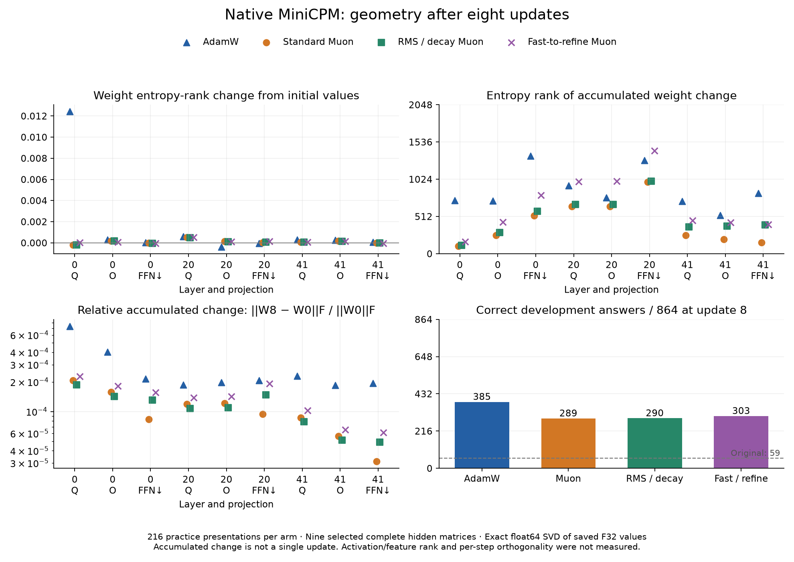

# What changed in the matrices after eight updates?

The selected whole weight matrices barely changed in effective rank, even while
answer accuracy improved. The accumulated AdamW changes had a higher **median**
entropy effective rank than the three Muon variants in this slice. These
measurements do not establish that Muon learned higher-rank features, or that
higher rank caused better answers.



All four full-update arms received eight updates and 216 ordered practice
presentations. Scores use the same frozen 864-question development panel and
the same COW evaluation runtime. Each geometry result is joined to the scored
checkpoint by its full model SHA-256, rather than an arm label alone.

| Arm at update 8 | Correct / 864 | Previously wrong answers gained | Original correct answers lost | Median entropy rank of W8 − W0 | Largest absolute weight entropy-rank change | Median relative Frobenius change |
| --- | ---: | ---: | ---: | ---: | ---: | ---: |
| AdamW | 385 | 341 | 15 | 772.57 | 0.0124223 | 0.02080% |
| Standard Muon | 289 | 240 | 10 | 252.06 | 0.0005179 | 0.00944% |
| RMS / decay Muon | 290 | 241 | 10 | 393.91 | 0.0004650 | 0.01097% |
| Fast-to-refine Muon | 303 | 255 | 11 | 459.34 | 0.0005138 | 0.01425% |

The original scored 59/864. Its median whole-weight entropy rank across these
nine matrices was 1495.02. Some individual fast-to-refine changes had higher
entropy rank than AdamW; the median is not an ordering of every matrix. Gains
and losses count the same original questions separately: a better total does
not mean earlier successes were retained.

## What was measured

PCC's existing `experimental/native_training/matrix_geometry.py` extracted nine
complete hidden matrices: attention Q, attention output and FFN down projection
in blocks 0, 20 and 41. The original F32 model and four update-8 checkpoints
produce 45 matrix measurements. Each includes all singular values, computed by
NumPy's float64 SVD, for the saved weights and their accumulated difference
from the original. No submatrix, randomized projection or truncated SVD was used.

For singular values σ, entropy effective rank is `exp(−Σ p log(p))`, with
`p = σ / Σσ`. Stable rank is `Σσ² / max(σ)²`; energy participation rank is
`(Σσ²)² / Σσ⁴`. The complete data includes these measures, norms, matrix
dimensions, model identities and checkpoint configuration receipts. Zero
matrices have zero rank in this diagnostic.

Float64 analysis measures the values already saved in F32. It cannot recover
unrounded training updates. `W8 − W0` includes eight accumulated steps,
cancellation, decay where enabled, and storage rounding. It is not one Muon
projection or a measurement of per-step orthogonality. Activation/feature rank,
embeddings, output heads, normalization weights and other hidden projections
were not measured. LoRA effective weights are not included; the failed merged
LoRA equivalence gate remains unchanged.

## The declared optimizer settings matter

| Arm | Hidden-matrix learning rate | Shape scaling | Hidden decay | Projection |
| --- | ---: | --- | ---: | --- |
| AdamW | 1e−6 | Elementwise AdamW | 0 | Not used |
| Standard Muon | 5e−5 | Original | 0 | Five fast polynomial iterations |
| RMS / decay Muon | 5e−6 | RMS | 0.1 | Five fast polynomial iterations |
| Fast-to-refine Muon | 5e−6 | RMS | 0.1 | Fast projection, then five refinement iterations from global update 4 |

Muon uses momentum 0.95 with Nesterov; its auxiliary parameters use AdamW at
1e−6, with decay 0 for standard Muon and 0.1 for the two variants. AdamW uses
β1=0.9, β2=0.95 and ε=1e−8. The serialized AdamW configuration also contains
inactive Muon defaults: those fields do not mean AdamW executed Muon projection.
The measured checkpoint headers preserve the actual floating-point settings.

These are the declared learning trajectories, not an isolated ablation of
projection geometry. Learning rates, scaling and decay differ. This early slice
does not select an optimizer winner or establish that rank predicts learning.
The equal-update curves, retention, later checkpoints and broader tasks remain
necessary. Time is recorded as a resource observation, not the scientific
stopping rule.

## Reproduce with the existing engine diagnostics

Use authorized Linux hosts and pinned PCC source. Keep full models local to their
host; this analysis needs saved matrix subsets, not a second inference runtime.

1. Use PCC's `matrix_geometry.py extract` command for the same declared complete
   matrix names in the original and each candidate. Supply each actual model's
   SHA-256. Extraction checks the model before and after reading and records
   hashes for every `.npy` matrix.
2. Save a private manifest with exactly these fields:

   ```json
   {
     "schema": 1,
     "baseline_subset": "/owned/subsets/original",
     "candidates": [{"label": "adamw-full", "subset": "/owned/subsets/adamw-full"}],
     "behavior_file": "/owned/frozen-development-summary.json",
     "update": 8
   }
   ```

   The behavior summary uses the `PARTIAL_CURVE` schema illustrated by
   `shared-learning-block-aq.json`: baseline model identity, evaluation/runtime
   identities and one exact arm/update/model match per candidate. A full report
   includes all four candidates. It is a frozen input, not a live status file.
3. From S³, run the optional CPU integration:

   ```bash
   python -m sss_integration.optimizer_geometry \
     --pcc-root /owned/pinned-pcc \
     --manifest /owned/geometry-manifest.json \
     --output /owned/new-geometry-report --workers 5 --blas-threads 2
   ```

   The output directory must be new. Independent model jobs use PCC's actual
   checked reader and measurement code. The wrapper verifies subset identities,
   joins the scored model hashes and preserves partial failures. A partial result
   is not a completed block. Source, input and output evidence hashes are retained.
4. Render this particular update-8 figure with
   `python scripts/plot_optimizer_geometry.py`; NumPy and Matplotlib are optional
   analysis dependencies, not dependencies of the S³ core.

The first analysis used 16 independent matrix workers with two BLAS threads each
and completed in 159.58 seconds, including extraction and hashing, on the shared
A100 server's CPUs. No GPU, inference or training ran for the analysis. This is
not optimizer training time, a controlled parallel speedup, or a comparison of
GPU throughput. Other shared activity can affect timings.

[Complete measurements and matched scores](../validation/minicpm-native-learning-20261024/optimizer-geometry-au.json)
and [the current learning curves](COW-SHARED-ROOT-LEARNING.md) preserve the
distinction between numerical observations, behavior and unfinished acceptance.

The optional integration lane (`PCC_SOURCE_ROOT=/owned/pinned-pcc python -m
unittest -v sss_integration.test_optimizer_geometry`) passed four checks against
actual tiny GGUF files: a scored saved-matrix join, foreign scored-model refusal,
corrupted-matrix refusal and protection of immutable subset directories.
[CPU integration evidence](../validation/minicpm-native-learning-20261024/geometry-wrapper-cpu-ax.json)
records these controls separately from the real model measurements.

The final reusable wrapper reproduced all 720 scalar geometry values across the
45 real-model measurements exactly, using five CPU workers and two BLAS threads
each. It took 89.73 seconds on the already extracted subsets; this excludes the
first run’s model extraction and is not a controlled speed comparison.
[Wrapper results](../validation/minicpm-native-learning-20261024/optimizer-geometry-wrapper-ax.json)
and [same-input comparison](../validation/minicpm-native-learning-20261024/optimizer-geometry-wrapper-control-ax.json)
retain source and evidence hashes. Both executions use PCC’s same diagnostic,
so agreement checks integration and provenance, not an independent SVD oracle.
