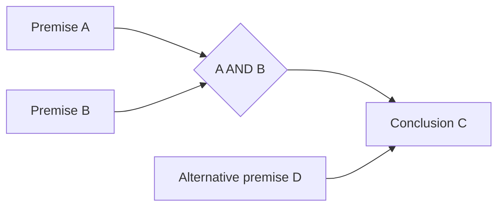

# Reasoning connections, checked independently

**Strengthened by ideas incorporated from [LearnHarness](https://github.com/amosblomqvist/learnharness).**
S³ now has four original bounded exercise families inspired by its joint-premise
arguments, method discrimination, reverse questions and premise-change practice.
The implementation and examples were written for S³; no upstream code or examples
were copied. [Source review and precise credit](LEARNHARNESS-REVIEW.md).

## Three different graphs or records

1. **Skill prerequisites** say which abilities prepare a learner for another
   ability. They live in `sss/catalog/skills/` and `SkillGraph`.
2. **Arguments inside a lesson** say which explicit assumptions jointly imply a
   conclusion, with alternative routes kept separate. They live in the bounded
   exercise and its `reasoning-evidence.json`.
3. **Assessment records** say what a specific model/profile actually passed,
   including the three gates and preservation of previous successes. They remain
   in the frozen evaluation and guard machinery.

A completed lesson is not mastery. A correct formal exercise is not evidence that
its premises describe the world. A model-generated natural-language argument is
not automatically a verified proof or approved thinking target.



The conjunction requires A and B together. D is another route to C. Withdrawing B
blocks the first route but does not block the second if D is still established.
An arrow never licenses the converse: C alone does not establish A, B or D.

## What is executable

| Skill | Task | Independent checking |
| --- | --- | --- |
| `logic.joint_premises` | Supply a valid proof using joint premises and alternative routes | Replay every rule against established facts, plus exhaustive truth assignments |
| `logic.premise_robustness` | Withdraw a fact; prove the remaining conclusion or supply a counterexample | Check every remaining fact and rule and require a false query in a counterexample |
| `logic.reverse_support` | Find the fewest additional assumptions that suffice | Accept any smallest set; reject larger sets, invented assumptions and invalid proofs |
| `math.method_selection` | Choose addition, subtraction, multiplication or division in similar stories | Check both the selected operation and a separate numeric equation |

The logic format is positive propositional Horn rules, bounded to ten atoms and
32 rules. Missing facts are unknown. Cycles cannot prove themselves. These are
small explicit tasks, not arbitrary natural-language theorem proving, empirical
causation or autonomous research qualification. The generators construct proofs
by forward chaining; the entailment oracle independently enumerates truth
assignments. Alternative valid answers do not need to match a reference string.

Each family has independent, composition and transfer/recovery gates. Composed
logic tasks require multiple dependent steps; arithmetic adds follow-on
operations. Recovery includes both correct and incorrect earlier suggestions,
so blindly disagreeing is not sufficient. Split-specific inputs and protected
answers remain in the existing evaluation boundaries.

`research.findings` now lists premise robustness and reverse support among its
prerequisites. That research node remains planned and unmeasured. The new bounded
families do not silently expand an already frozen Wen training or evaluation pack.

## Use the existing S³ or BW interface

```sh
python -m sss exercise --skill logic.reverse_support --split practice --reference
python -m sss exercise --skill math.method_selection --gate composition --reference
python -m sss teaching-example --skill logic.joint_premises --delayed-revisit --output /new/owned/lesson
python -m branchwrite skills exercise --skill logic.premise_robustness --reference
python -m branchwrite skills teaching-example --skill logic.joint_premises --delayed-revisit --output /another/new/owned/lesson
```

The directory must be new. `--reference` exports answers only for practice.
No command above starts a model, allocates a GPU or updates weights. With matching
installed S³ source, BW's existing optional import handles the new families; BW
has no duplicate skill catalog or proof checker.

For a reference-only check through the existing frozen evaluator:

```sh
python -m sss explore reference --directory /new/private/reference-check --skill logic.joint_premises --skill logic.premise_robustness --skill logic.reverse_support --skill math.method_selection
```

Its 36 small diagnostic checks test the machinery, not a model. A live model
requires `explore prepare` with an inspected profile and the existing authorized
endpoint workflow. Broad qualification, retention and resource admission keep
their original requirements.

## A day with a delayed return

The `--delayed-revisit` fixture begins with joint-premise practice, interleaves
four near-matching arithmetic problems, then makes a causal compact working note.
An evening question withdraws a premise from the earlier problem. The original
problem is absent from the short note, so the fixture searches and rereads its
immutable archive record before producing a checked proof or counterexample.

The output includes `conversation.txt`, immutable `events/`,
`reasoning-evidence.json`, `revisit-note.json` and `revisit-evidence.json`. Receipts
bind the exercise, original question, checker source, answer and argument.
The note uses a 700-byte reference budget, not Wen tokens. This proves the
archive/verification route; it does not measure Wen recall, long-context quality
or a human learning schedule. The existing `school-day` schedule and archive APIs
remain the places for broader interleaving and continuation experiments.

Public owned examples are saved in
[`examples/finished-training-examples/reasoning-connections`](../examples/finished-training-examples/reasoning-connections/).
Finished means the artifact is complete. These new examples have not trained Wen.

## Project ownership

S³ owns these definitions, generators, proof checks, practice receipts and
assessment reports. BW retains task execution, permissions and its canonical
ledger. PCC retains inference, contexts, model identities, native backprop,
GPU admission and candidate versions. No LearnHarness application or agent runtime
is imported, and PCC has no new reasoning-graph dependency.

The first implementation is deliberately bounded. Later work can add richer
symbolic branches and evidence-linked empirical arguments, with new independent
checkers and honest coverage labels. In particular, a formal implication and an
experimental observation must never become the same unlabelled edge.

Validation: [93 core tests, 36 reference checks and six actual BW CLI calls](../validation/learning-program-20261024/reasoning-connections.json).
All passed on the authorized CPU host. No GPU or model inference was used for
this curriculum increment.
