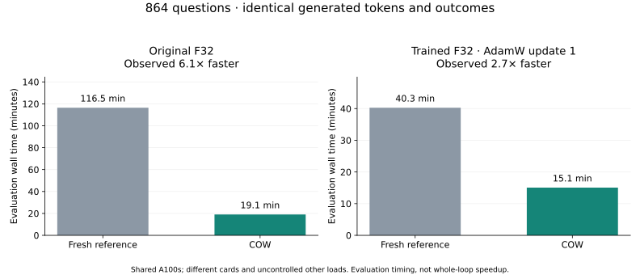
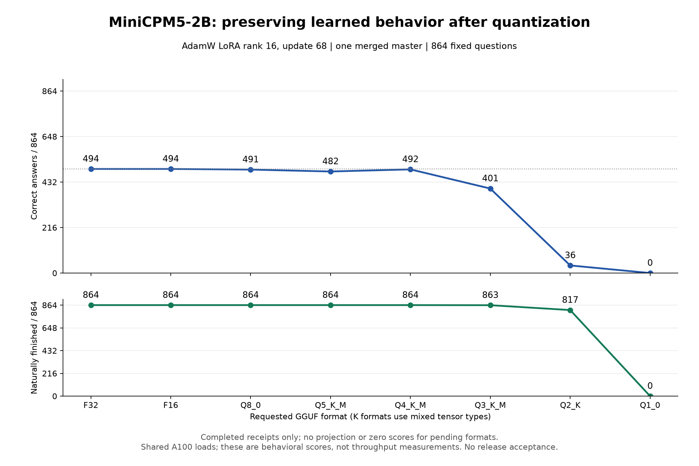

# A short tour of the measured results

Three questions organize this work: can we test faster, how do training methods
change learning and forgetting, and how much survives compression? These are
separate measurements. This page links the evidence and current graphs.

**S³** owns skills, lessons, scoring and regression reports. **PCC**, built on a
modified Strata core, owns model execution, COW context reuse and native training.
**BW** is the workflow/tool harness and a client for the learning controls.

## 1. Faster evaluation with the same answers

The trained-model assessment fell from **40.3 to 15.1 minutes: 2.7×**. Both paths
used the same weights and produced identical token sequences and answer/finish
outcomes on all 864 questions. The original-model assessment separately measured
116.5 to 19.1 minutes, or 6.1×. These ran on shared A100 cards with other loads;
they are observed comparisons, not isolated benchmarks or universal guarantees.
The timings measure evaluation, not a complete training campaign.

[Speed measurements, llm-60 results, method and caveats](https://github.com/CC-David-CC/sss/blob/feat/learning-stack-20261026/docs/COW-FIRST-DATA-BLOCK.md)
· [PCC's conservative 4.8× small-probe headline](https://github.com/CC-David-CC/Private_Context_COW/tree/feat/learning-runtime-unified-20261026#48x-faster-on-small-forward-work-probes)

## 2. AdamW, Muon variants and six LoRA ranks

The comparison uses **68 updates and ordered practice**, not equal training
time. The chart includes full AdamW, standard Muon, RMS/decay Muon, fast/refine
Muon, and AdamW LoRA ranks 1, 2, 3, 4, 8 and 16. Lines end at completed
measurements. Only rank 16 has reached update 68 in this snapshot; unequal
update counts and the recorded execution-path differences prevent a final
optimizer or rank ranking. Full updates use F32 weights; LoRA uses an F16 base
and its attached adapter.

[Latest training charts and all ten arm counts](MINICPM-UPDATE-CURVES-PROGRESS.md)
· [Per-update gains and losses](MINICPM-UPDATE-CURVES-PROGRESS.md#what-changed-underneath-the-total-score)

## 3. Keeping the learning in a smaller GGUF

For the completed rank-16 checkpoint, F32/F16 scored **494/864**, Q8 **491**,
Q5 **482**, Q4 **492**, Q3 **401**, Q2 **36**, and Q1 **0**. All eight formats are complete.
The observed steep drop starts below Q4, with a nonmonotonic dip at Q5.
These are the same 864 questions through the same standalone evaluation path.

Q4's approximately **1.454 GiB** file has nearly the F32 total score, but it
gained 20 correct answers and lost 22 others. Similar totals do not mean
unchanged behavior. This is a measured development result, not a release decision.

[Precision scores, sizes, gains/losses and explanations](RANK16-PRECISION-PROGRESS.md)

## What remains unfinished

The other training arms, broader workflow and research skills, and final
acceptance remain open. A separate joined BW/PCC/S³ native round completed its
train/test/decision/preserve cycle. Its candidate lost 20 review passes without
improving the workflow score, so the working parent stayed unchanged. No trained GGUF has been uploaded or accepted for release.
These are results from an active development project, not a finished product
benchmark or a claim of general autonomous competence.

For the software itself: [PCC](https://github.com/CC-David-CC/Private_Context_COW/tree/feat/learning-runtime-unified-20261026)
and [BW](https://github.com/CC-David-CC/BranchWrite/tree/fix/terminal-failure-observation-20261026).
These links deliberately select the published development branches containing
this work; the repositories' default branches can be behind the experiment.
